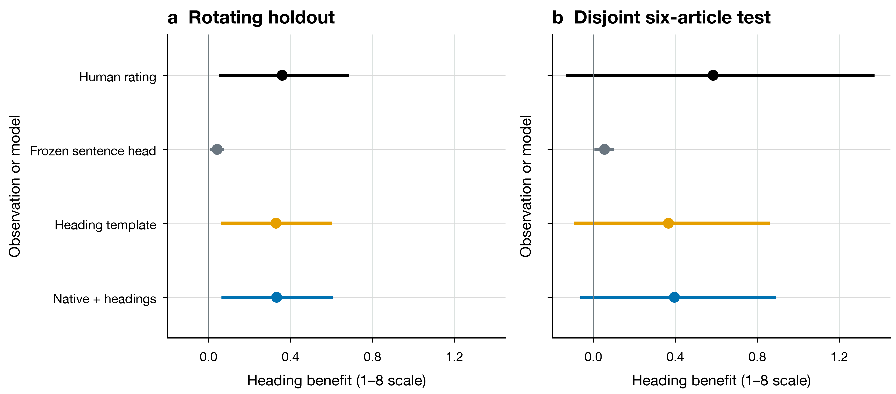

# Learning from whole-article ratings recovered the average benefit of an explicit heading template

PLABA-trained sentence ratings predicted a +0.042-point average improvement when the four original section headings were added to a psychology research summary. Human readers reported a +0.359-point improvement. We fitted a single article-level adjustment to the available whole-article responses. Across held articles and reader blocks, the adjusted native model predicted **+0.332** and a text-only rule predicted **+0.329**. Learning at the level of the human observation recovered much of the group mean. The native model added no resolved accuracy over reading the four headings from the text. [Unadapted external test](native-heading-results.md) · [Registered adjustment](heading-adaptation-protocol.md)

| Average over the 12 articles | Human or predicted benefit, 1–8 points (95% interval) | Mean absolute article-effect error | Individual-rating RMSE |
|---|---:|---:|---:|
| Observed human comprehensibility | +0.359 (+0.059 to +0.679) |  |  |
| Frozen PLABA sentence observer | +0.042 (+0.016 to +0.067) | 0.386 | 1.828 |
| Source intercept and visible heading template | +0.329 (+0.068 to +0.594) | 0.339 | 1.757 |
| Native sentence observer, source intercept and same heading term | +0.332 (+0.071 to +0.598) | 0.345 | 1.745 |

We held out the entire article and one of five participant blocks for each prediction. All 1,283 ratings entered evaluation once; each training set contained 924–970 ratings from other articles and other readers. For each training article we computed the mean observed heading benefit after subtracting the corresponding fixed prediction. The new coefficient was the sum of those residual benefits divided by the number of training articles plus one, equivalent to shrinking the offset toward the effect of one zero-benefit article. The coefficient was free to take either sign. At inference the cue was the four standalone heading lines in the displayed English article, with or without the original numbering. Raw treatment codes were used only to check recovery of the source design. The single-pass encoder outputs were reused. [All 60 pairs of fitted readouts and their held-article residuals](../results/reading-validation-local/native-headings/crossed-adaptation.json)

The adjusted native observer’s mean contrast differed from the human contrast by −0.026 points (95% interval −0.099 to +0.032). Its per-article absolute error relative to the heading-only comparator changed by +0.005 (−0.041 to +0.035), and individual-rating RMSE changed by −0.013 (−0.077 to +0.044). After removing each method’s mean benefit, absolute article-effect errors were 0.318 for the frozen observer, 0.339 for the simple rule and 0.345 for the adjusted native observer. The training sets for the 60 fits overlap. Averaging their source-mean shifts therefore **mechanically tends to reproduce the mean of this same study**, even when a model cannot distinguish which article will benefit. The group-average comparison alone provides little evidence for transferable prediction. [Full crossed effects and uncertainty](../results/reading-validation-local/native-headings/crossed-adaptation.json)

## One disjoint test of articles and people

We next fixed a single partition by cryptographic ordering of article DOI and reader ID, before calculating the partition’s scores. Training used 316 ratings from 83 people on six articles. Evaluation used 323 ratings from 83 different people on six different articles. We excluded the other 644 observations and kept the original fitting rule. The rows of the fixed-partition table have substantially wider uncertainty because each rectangle contains only six articles. Both rectangles belong to the previously examined study. [Registered partition](heading-fixed-split-protocol.md) · [Exact articles, arm counts and forecasts](../results/reading-validation-local/native-headings/independent-rectangle.json)

| Six held articles and 83 held readers | Benefit, 1–8 points (95% interval) | Mean absolute article-effect error | Individual-rating RMSE |
|---|---:|---:|---:|
| Human responses | +0.584 (−0.127 to +1.363) |  |  |
| Frozen sentence observer | +0.054 (+0.014 to +0.093) | 0.661 | 1.819 |
| Source intercept and heading template | +0.366 (−0.088 to +0.852) | 0.560 | 1.710 |
| Native observer, intercept and heading term | +0.395 (−0.056 to +0.883) | 0.547 | 1.707 |

The native plus heading model’s contrast differed from the observed held benefit by −0.189 (−1.061 to +0.656). Its paired absolute article-error difference relative to the heading-only model was −0.013 (−0.064 to +0.043). The corresponding individual-rating RMSE difference was −0.003 (−0.099 to +0.068). The source evidence supports a template-level adjustment. Accurate estimates of which particular articles, sentences or readers will benefit require independent source evidence with more varied organization. [Fixed-partition uncertainty and source design](../results/reading-validation-local/native-headings/independent-rectangle.json)

Both analyses independently resampled subjects and articles and refitted all coefficients in 10,000 estimable bootstrap replicates. The fixed partition resampled within its training and test sets separately. A resample with an absent required arm has no defined contrast. We replaced 15 such draws in the rotating analysis and 13 in the fixed partition. All interval calculations preserved the original held-out assignments and the protected grade-free model inputs. [Printable figure](../results/reading-validation-local/native-headings/article-adaptation.pdf) · [Crossed calculation](heading_adaptation.py) · [Single-partition calculation](heading_fixed_split.py)
