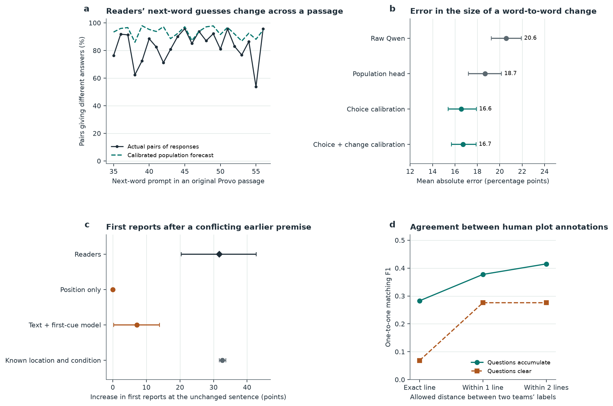
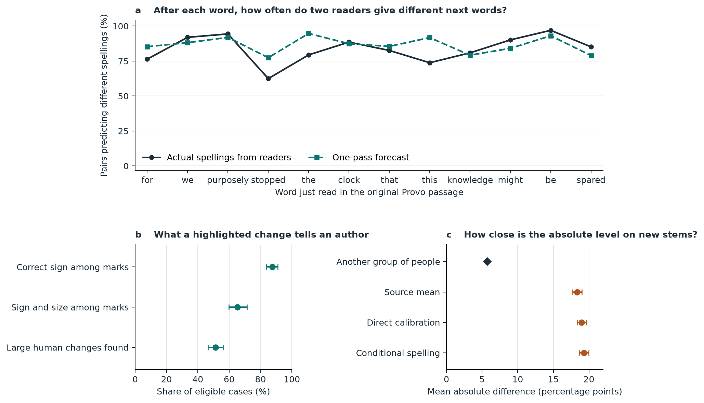
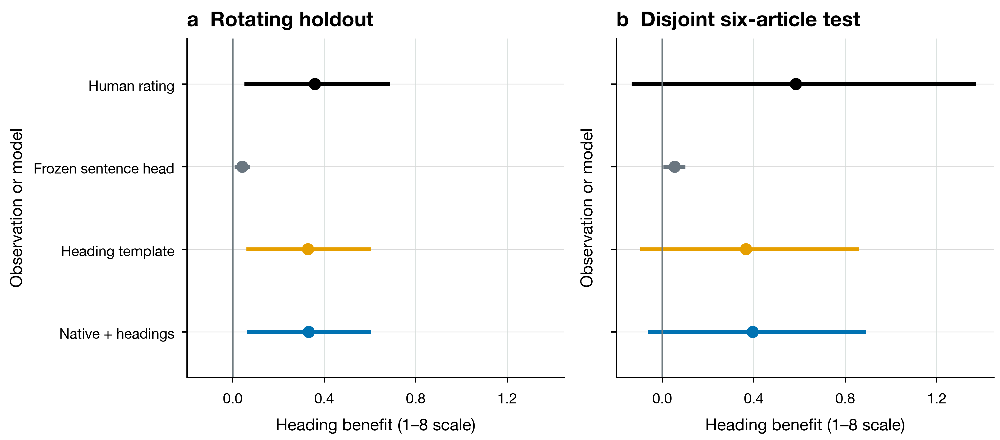

# Which changes in human reading can be recovered from one pass through a language model?

## Abstract

A writer can change a reader’s expectations with one word or make an entire explanation easier to follow by adding headings. We tested whether a frozen causal Qwen3.5-2B model could recover such changes from a single exposure to the printed article. Each readout learned from the response people actually gave, at the position where they gave it. In 46 English paragraphs, training on readers’ distinct spellings reduced mean error in the size of a word-to-word expectation change from 18.58 to 16.40 percentage points. Among 482 conservative interface marks, 422 correctly indicated whether readers’ next guesses widened or narrowed. Adding headings to unchanged scientific summaries increased comprehensibility by .359 points on an eight-point scale. Averaging sentence estimates recovered .042 points. A document-level correction fitted on other articles and people within the study recovered .332 points, closely matched by a heading-only rule (.329). More demanding tests exposed a limit. In 233 readers, changing an earlier premise increased first inconsistency reports at the same later sentence by 31.7 points; an article-only first-cue model predicted 7.1. These results establish localized forecasts of specific population responses. Accurate timing and magnitude of an individual’s unresolved cognitive difficulty remain open. [Spelling-level measurements](spelling-agreement-results.md) · [Observed highlights](word-mark-certification-results.md) · [Native heading intervention](native-heading-results.md) · [First reports](first-cue-results.md)

**Figure 1.** **a**, Actual and predicted probabilities that two next-word responses fall in different study categories (8,192 named spellings plus one residual category). The interval comes from a median-length consecutive run of denominator-verified original observations, selected using text geometry alone. **b**, Absolute error in the change at the word just read, with 95% passage-bootstrap intervals over verified positions. **c**, Difference in first-report probability after an earlier premise changes. Intervals resample readers within experimental arm and complete story families. The known-location diagnostic receives the experimental condition and critical sentence. **d**, Agreement of the two annotation teams on definite changes in outstanding questions in three German literary works. Each line change can be matched only once. The curves in these panels have different empirical units. [Printable figure](../results/reading-validation-manuscript/observed-reading-changes.pdf) · [Plotted example and selection rule](../results/reading-validation-manuscript/figure-data.json) · [Exact human positions](narrative-agreement-results.md)

## What an author can infer

**A reader population's expectations at the next word.** For each prefix let p be the predicted distribution over the next words people will supply. The chance of two independently sampled responses differing is D = 1 − Σp². D after the current word minus D before it locates a widening or narrowing at that word. The published counts identify this change at **word ends**. In Provo, 71,647 responses at 1,791 verified positions in 46 paragraphs gave 1,566 adjacent pairs. With answers grouped into the 8,192 named words and one residual category, the original contextual observer tracked the magnitude and direction of signed updates with rank correlation .631. Seven changes were exactly zero. The 74.2% directional score exceeded calibrated Qwen by 1.99 points [.62, 3.37], but its difference from raw Qwen was .64 points [−1.18, 2.35]. Inside sentences, word ends following two ordinary lowercase forms still gave 76.3% directional agreement. A new readout calibrated on predictions made with the source sentence held out improved the estimated size of changes. The choice-only and joint eight-parameter models also reduced word-choice loss by .0225 and .0393 nats per response on 3,085 independent stems. Both simultaneous intervals excluded zero. Error in absolute disagreement still approached 30 percentage points on these stems. When another group read the same passages naturally, adding either the predicted or the observed word disagreement to a strong lexical model failed to improve prediction of looking back. In the author interface we marked a change only when every possible allocation of the unlisted probability allowed at least a 20-point change in that direction. Compared with people’s actual spellings, 422 of 482 marks matched direction and 315 met the claimed size. The rule captured 315 of 614 large human changes. Native Qwen using the same rule achieved similar precision. [Population results](cloze-population-results.md) · [Changes inside sentences and magnitude calibration](word-dispersion-results.md) · [Independent rereading observations](expectation-rereading-results.md) · [Marks against actual spellings](word-mark-certification-results.md)

A second observer learned directly how often two people chose the same actual spelling. Separate likelihoods for named and unlisted answers reduced the error in signed change to 16.40 points [15.30, 17.59], compared with 17.41 for direct calibration and 18.58 for the grouped distribution. The change advantage over direct calibration was 1.01 points [.31, 1.72]. At 3,085 stems from a different laboratory, absolute level error remained 19.15 points; the constant average from the training study performed better at 18.12. In 256 splits of the same 233 people, two comparatively sized reader groups differed by 5.71 points on average, whereas this model missed the same groups by 19.29. A study-specific intercept learned on 760 answers from 32 other people brought the held mean to 67.49% against 68.34% observed; absolute error remained 16.99 points. Its advantage over an equally calibrated raw backbone was uncertain. [Training on complete spellings](spelling-agreement-results.md) · [Human sampling agreement](spelling-agreement-human-precision.md) · [Disjoint population calibration](reading-population-calibration-results.md)

**Figure 2.** **a**, Each word names the word just read. The solid line comes from people’s actual written guesses for the next word. The dashed line is the fitted full-spelling estimate. The twelve consecutive word ends are the first twelve positions in the geometry-selected run of Figure 1. **b**, Confirmation of underlines in 46 Provo paragraphs. The first two percentages use 482 marks as denominator. The last uses 614 large human changes. **c**, Prediction of full-spelling disagreement in 3,085 Peelle stems, evaluated against the same half of the readers. Each participant stayed in one half across all stems. Intervals resample paragraphs in b and stems in c. [Printable figure](../results/reading-validation-manuscript/human-word-expectations.pdf) · [Printed words and exact values](../results/reading-validation-manuscript/spelling-figure-words.csv)

**The earlier passage a reader is using.** In a reference game, people could introduce a new entity or click words referring to an earlier one. A forecast that puts probability on all allowed actions and all earlier words can be scored without first assuming the reader linked something. In 11,309 decisions in 91 new works, context reduced its full-event loss from .7767 to .7078 nats. The effect among linked nouns with no earlier literal match was +9.4 points [.9, 17.8] in top-word accuracy. Requiring both new game players and new works left 47 decisions and an inconclusive difference. On an earlier panel of pronouns with at least four eligible backward-reference clicks, the head hit the selected referent in 78.4% of 2,196 decisions across 37 texts. This is useful when an author selects a pronoun they intend to refer back. Directly transferring the same noun-pointer evidence to first contradiction reports worsened path loss by .112 nats [.028, .201]. Clicking a referent supplies direct labels of identity that a reading-time series cannot provide. [Independent works and full action space](nominal-reference-results.md) · [Pronoun clicks](transition-pointer-results.md) · [Transfer to first reports](first-cue-results.md)

**A professional reader's verdict on a complete passage.** In SEAHORSE, raters initially saw only the summary and answered whether they could read and understand it. On the official English test there were 4,355 judgments across 1,005 articles. One summary consisting of a single space produced five judgments and no usable word; all five recorded judgments reported difficulty. One other rating was unsure. On the remaining 4,349 definitive judgments, the summary-only head gave AUROC .842 [.811, .870], average precision .307 and log loss .1484. A fitted form-and-word-surprisal model gave .830, .299 and .1581. At the source-selected alert threshold the model recovered 92 of 206 difficult summaries. One in three alerts corresponded to a difficulty verdict. Generator and corpus identity alone gave AUROC .847. When holding generator and corpus constant, the text head retained AUROC .721 and the lexical comparator .708, with an inconclusive paired difference. The authors’ published mT5-Large specialist, supplied with both the source article and summary, achieved .913 AUROC and .431 average precision. The human Q1 raters and CogLLM received the summary alone. Among Spanish summaries judged understandable, an English-trained model ranked overt repetition with AUROC .944 and grammatical issues with .613. Word form and predictability alone gave .940 and .634 respectively. The original ratings apply to complete summaries. [Official source and reader instructions](https://aclanthology.org/2023.emnlp-main.584/) · [Coverage and specialist comparison](transition-seahorse-results.md) · [Conditional repetition and grammar judgments](transition-seahorse-gated-results.md) · [Independent Spanish judgments](transition-seahorse-spanish-results.md)

**Which textual changes are actionable.** On 39 held film summaries the default character screen had word F1 .799 under determinate annotation, versus .687 for a named-entity and surprisal model. Its all-word paired F1 improvement remained positive for every location compatible with the source's repeated strings. On an additional untouched movie the eligible prefix had 1,777 words, and the paired advantage was .022–.064. Across 265 author-aligned biomedical sentence rewrites, the observed mean ease gain was .537 on a five-point scale and the text readout predicted .497. In biomedical abstracts the top wording candidate matched 45 of 94 expressions explicitly named by readers, with the sentence supplied. In independent learner essays the generic continuity alert recovered only 114 of 446 marked breaks. Given two plausible rewrites of the same problematic passage, the model selected the editor's preferred one in 84 of 256 unequal comparisons. In contrast, when the choice was between the problematic original and its expert replacement, joint supervision from expert decisions and edits favored the replacement in 135 of 203 cases. A mark can help an author inspect a passage. Reliable selection between alternative edits remains open. [Character alerts and false positives](transition-writer-balanced-results.md) · [Biomedical expressions](local-results.md) · [Essay boundaries](transition-external-results.md) · [Expert-marked originals and replacements](transition-essay-rewrite-results.md) · [Direct expert choice between repairs](transition-essay-human-choice-results.md)

Holding the body sentences of scientific summaries fixed separated organization from local wording. Kerwer et al. added section headings and obtained 1,283 article ratings from 166 readers across twelve source articles. Headings increased mean comprehensibility by .359 [.062, .676] on an eight-point scale. The deployed full-state sentence readout, averaged across 181 matched sentence pairs in 24 one-pass texts, predicted .0416 [.0152, .0674]. Supplying the entire 2,048-dimensional sentence state left the estimated effect virtually unchanged relative to the earlier 32-dimensional projection. We then fitted one document-level shift for the visible heading template on other articles and other people within the study. Across held folds the predicted gain rose to .332 [.071, .598]. A heading-only rule trained on the identical ratings gave .329 [.068, .594]. Per-article error was .345 for the adapted native model and .339 for the heading-only rule. The source and test sets differ in every fold, but the rotating fits share a study-wide effect. Reproducing the average under this design does not identify which future article will benefit most. In a single nonrotating test on six new articles and 83 held readers, the observed effect was .584, the adapted native estimate .395 and the heading-only estimate .366. The adapted-minus-human difference was −.189 [−1.061, .656]. [Original experiment](https://doi.org/10.1525/collabra.18898) · [Matched full-state results](native-heading-results.md) · [Article-level adaptation, controls and independent partition](heading-adaptation-results.md)

**Figure 3.** The same body sentences were shown with or without headings. **a**, Each article and one block of readers were excluded in each training fold. **b**, One fixed split assigned six articles and 83 people to calibration and completely different articles and people to testing. Points are mean effects on the source’s eight-point scale. Bars show 95% intervals with reader and article variation. The format-only rule and native model both learn from whole-article ratings. [Printable figure](../results/reading-validation-local/native-headings/article-adaptation.pdf) · [Ratings and matched controls](heading-adaptation-results.md)

The same narrative feature design transferred to three backbones when each had its own source-trained readout. For unexplained characters, native full-state average precision was .846 on Qwen3.5-2B, .845 on LFM3-1.7B-Base and .737 on Gemma 4 E2B. Their matched entity-and-surprisal controls gave .662, .674 and .659. For missing context about an event or object, corresponding improvements were .146, .149 and .127. For unclear reference without restricting candidates to personal pronouns, none of the three improved reliably. English release evidence does not by itself extend to Chinese scientific writing. A separate Mandarin study measured which of two people a respondent mentioned after a verb, a more specific claim. [Identical materials across three backbones](transition-direct-results.md) · [Mandarin human continuations](transition-mandarin-results.md)

**What reader context adds.** With no reader context the observer predicts a population distribution. In a second laboratory, 233 identified people supplied 297,927 genuinely later word choices. Twenty prior choices improved predictions over an unadapted source population, but the advantage of the correct person's history over a material-matched stranger was uncertain. A subsequent model allowed a person to switch response styles across words and learned how strongly to trust their measured tendencies. Across 284,385 later choices, own history improved .00221 nats [.00152, .00299] over a population pool with equally rich experience. A median of 412 earlier choices was available. The English outcomes had previously been analyzed for another method. A separately registered German replication used German coefficients fitted on 133 auditory participants. Across 9,602 answers from 98 unseen visual readers on 140 written-only stems, the correct history improved loss by .00182 nats [.00073, .00312] over an equally informed pool. The advantage over a single matched stranger remained uncertain. Lexical coverage was 49.3%, and the chronology of individual German trials is unavailable. The fitted response types change concentration and residual mass while preserving the order of named words. The studies identify a small reader-specific calibration effect. Topic-specific knowledge remains unmeasured here. [Chronological reader evidence and controls](reader-history-results.md) · [Response-style mixture](reader-history-mode-mixture.md) · [Independent German estimates](muse-results.md) · [Tests of changing the favorite word](reader-frequency-rank-results.md)

## A direct test of accumulation, resolution and changing subject

For source s and current position t, the model can estimate a nonnegative opening mass and a conditional chance that this same source remains open. Summing surviving mass yields a stock expressed in *expected open questions* when trained on question counts. A clue can raise processing demands at the current word while reducing that stock. A focus switch can make a prior subject less accessible while leaving its question unanswered. Treating all three events as an obligatory fall in a single score would make independent tests of these possibilities impossible. [Count and survival likelihoods](stock-process-protocol.md) · [Experiments on old-goal accessibility](transition-goal-access-results.md)

In the controlled English inconsistency experiment, a source-trained reporting-propensity model improved full-path loss from 2.133 to 2.038 nats relative to its matched fixed-propensity version. Its prediction of the intervention effect was only 4.1 points. Direct effect supervision reached 19.0 points in another model, while increasing full-path loss from 1.787 to 3.487. A diagnostic that was told the actual critical location and condition recovered 32.6 points. Finding the event from the unmarked article remains the bottleneck. [Estimating the first report](first-cue-results.md) · [Stable differences in reporting](reporting-propensity-results.md) · [Cost of optimizing the intervention alone](intervention-moment-results.md)

The most direct available public annotation set contained 222 individually identified questions in four complete German originals. At the maximum annotated drop per story, a model explicitly trained to let one clue close multiple issues estimated 0.10 closures on average, versus 5.75 observed. When one team identified a definite decline in the three doubly annotated texts, the other team agreed on only four of 58 team decisions at the exact line. One-to-one matching identified two distinct exact decline pairs and eight pairs within one line. One team placed an 11-question drop at a line where the other recorded no net change. In another work, both placed a four-question drop one line apart. Even the original annotations therefore carry substantial uncertainty about location, magnitude and which questions a reader entertained. When two questions were still active and one was known to close, the identity of the closing question was recovered in 63.7% of comparisons; elapsed duration alone achieved 70.8%. The study’s live suspense ratings measure a different response. [Same-issue choice and elapsed-time comparator](stock-process-results.md) · [Synchronized closure forecasts](narrative-discharge-results.md) · [Human-to-human timing and scale](narrative-agreement-results.md) · [Original narrative experiment](https://doi.org/10.1017/langcog.2025.10057)

An experimental change of goal diminished access to the old goal after a common final sentence. After word controls and inverse-distance retrieval, unprompted native attention gave the direction of the published human group effect in 25 of 32 story families. The original study released aggregate human latencies for this contrast. The magnitude of the model contrast was .109 [.066, .157] in log retrieval units; readers' original recognition latency differed by 74 ms. Repeating the same method in a separate experiment failed to reproduce the adjusted name contrast after a switch to a new protagonist. It also failed for an associated object that the later paragraph never named. People recognized that object 41 ms faster when the original protagonist was rementioned; the adjusted model contrast was −.0001 [−.0248, .0229]. Indirect retrieval through words associated with the object produced the human direction in 31 of 32 raw comparisons, as did inverse distance. Matched earlier control words gained even more access, removing the apparent object-specific effect. An unusual transition in an arbitrary essay remains a substantially stronger inference. [Goal intervention](transition-goal-access-results.md) · [Character and object interventions](character-access-results.md) · [Indirect retrieval and matched controls](event-reinstatement-results.md)

## Model, training and inference

**One exposure.** Let hₜ = F(x₁,…,xₜ) denote the causal representation at token t. All hₜ, the recorded native attention relations and token probabilities are recovered in one forward over the printed article. No answer is generated. A head reads hₜ, earlier states or verified word-end positions. A whole-passage readout is allowed to pool the entire observed passage. It cannot be used to infer an earlier time of onset. Repository-specific serving checks count real encoder calls and compare unchanged prefixes with different endings. Frozen heads can be run concurrently on the same original exposure. Distinct experimental observers in this article have separate parameters and validation records. [Word-end serving check](population-serving-protocol.md) · [Reader interface and launch](../../docs/try-cogllm.md) · [Pinned backbone files](../backbone_transfer/models.json)

**Different human measurements contribute different likelihoods.** The joint archive contains 24 datasets and 62 endpoints with study-specific supports and likelihoods. The clicked-word and censored question-lifetime studies described here have their own source files, readouts and evaluation records. Let Yⱼ be an original response and Sⱼ the support supplied by its study. Fit −log Pⱼ(Yⱼ | h at Sⱼ) only for observed entries. A reader's click supplies a probability mass over its admissible earlier words, an interval closure supplies survival through its lower bound and the probability of closing before its upper bound, and a document rating supplies one document likelihood. Reader trial multiplicities are preserved without treating repeated words, people or materials as independent replications. This structure permits a differentiable joint objective; the experiments used supervised or likelihood-based optimization. [Complete observation ledger](../../docs/research/union_training/observation-protocol.md) · [Adaptive method and study coverage](adaptive-family-results.md)

**How shared parameters can help.** Each response can borrow from a shared expert and a private expert while retaining its original likelihood. Estimate how much to borrow from calibration materials and account for paired variation by resampling whole material families. In the globally separated confirmation partition, 741 held families contributed 8,834 archived rows and 86,740 endpoint-observation units across 51 endpoints and 20 studies. Against equal pooling the estimated reduction was .00233 nats [−.00167, .00751]. Against endpoint-specific calibration it was .00077 [−.00192, .00372]. Intervals simultaneously account for the two comparisons, linked studies and material variation. The estimates favor adaptive pooling in direction. Their uncertainty still admits equality. Training and calibration data from different sources sometimes reused the same OneStop article under different text identifiers. Results reported here group or quarantine those exposures. [Adaptive method, global correction and confirmation](adaptive-family-results.md) · [Alternative shared projections](source-directions-results.md)

The archive's 48-dimensional projection had itself been learned in earlier token-response work. One Frick family in each of the two newer evaluations had appeared in that upstream fit. Material withholding for a newly fitted borrowing rule does not erase this prior exposure. Removing the complete Frick source yielded gains over equal mixing of .00499 [−.00117, .01235] and .00233 [−.00188, .00770] across the two partitions. A narrower benefit of joint learning appeared on an observed ordering behavior. Over 639 selections in 94 human news arrangements, three-study training improved normalized choice loss from 1.0165 to .9624 relative to the identically structured independent native model. A lexical and surprisal model achieved .9556. [Validated data lineage](adaptive-family-results.md) · [Ordering experiment and strong controls](columbia-order-results.md)

**Which quantities are identified.** If observations depend on a latent score zₜ only through a freely learned readout fⱼ, replacing zₜ by a one-to-one transformation g(zₜ) and fⱼ by fⱼ ∘ g⁻¹ preserves every observation likelihood. Absolute “load units” therefore require an externally anchored observation or an independently justified measurement restriction. The probability of disagreement, probability of a report, and number of annotated questions each have such an anchor for their particular task. Assigning one of them the meaning of global cognitive effort would require additional evidence linking those measurements at matched positions. The Provo rereading comparison and the controlled first-report experiment are empirical tests of two such links. [Cross-panel reading test](expectation-rereading-results.md) · [First reports under intervention](first-cue-results.md)

## Evaluation, reuse and release decision

A separate study using headings phrased as questions helps interpret the direction of these effects. With headings, learners comprehended the text better and reported greater effort devoted to learning, which the investigators called germane load (3.89 versus 3.56, standardized difference .64). Improved comprehension can accompany increased productive effort. This published aggregate informed interpretation only. The authors make the individual data available on request. [Original experiment](https://onlinelibrary.wiley.com/doi/full/10.1002/acp.4076)

The experiments used existing public human observations without recruiting new participants. Linked reports document public sources, original stimuli and response units, inclusion rules, denominator checks, resampling, prior benchmark exposure and comparator inputs. Fitted source heads, forecast locks, numerical derivatives, estimates and code are stored alongside those reports. Some studies were studied repeatedly during development. A newly fitted readout on a familiar benchmark, a previously ungraded work, an independent reader cohort and a wholly new study supply different strengths of evidence. Multiple outcomes and related follow-ups prevent treating this collection as one confirmatory experiment. Forecast seals are local content hashes. They document which numerical forecasts were graded and provide reproducibility checks. They are distinct from an independently timestamped public preregistration. The formal archive reserve was kept separate from these development studies. [Study and data index](../../docs/README.md) · [Reproduction pathways](reproduction-index.md)

The English Gradio app renders the original words together with their marks. Fifty-four real paragraphs produced 54 native forwards. At all 2,500 verified word positions, each of five research word forecasts reproduced its numerical reference to within .00010. A user can inspect sentence ease, difficult wording, population next-word expectations and selected references while preserving each estimate's original meaning. Research forecasts on other corpora are reported where they were actually validated. The evidence supports a manuscript on which measured reading behaviors can be recovered, how far their effects transfer and where human observations constrain timing precision. A paper claiming a generally calibrated token-level model of human cognitive load, exact resolution of spontaneous individual questions, or universally better editing decisions does not meet that standard. [Working example of a population curve](../results/reading-validation-writer/word-expectations.html) · [Writer guide](../../docs/try-cogllm.md) · [Native replay](../results/reading-validation-spelling-agreement/native-serving-verification.json)

The decisive next test would use an intact, unseen article collection with human records identifying an earlier unresolved issue, the opportunity at which it was resolved or abandoned, and readers' response to an unchanged target after the preceding explanation changed. The evaluation would need to count false alarms on ordinary transitions, match the identity of a closing issue and report effect error in the human study's original units. An absence of suitable archived judgments limits the claim that can be tested with public observations alone. [Limits on human timing agreement](narrative-agreement-results.md) · [Original human response inventories](../../docs/research/union_training/observation-protocol.md)

## Selected primary studies

1. Gregor de Varda A, Marelli M, Amenta S. Cloze probability, predictability ratings, and computational estimates for 205 English sentences, aligned with existing EEG and reading time data. *Behavior Research Methods* 56, 5190–5213 (2024). [Publisher](https://doi.org/10.3758/s13428-023-02261-8)
2. Luke SG, Christianson K. The Provo Corpus: A large eye-tracking corpus with predictability norms. *Behavior Research Methods* 50, 826–833 (2018). [Publisher](https://doi.org/10.3758/s13428-017-0908-4)
3. Peelle JE et al. Completion norms for 3085 English sentence contexts. *Behavior Research Methods* 52, 1795–1799 (2020). [Publisher](https://doi.org/10.3758/s13428-020-01351-1)
4. Poesio M et al. A crowdsourced corpus of multiple judgments and disagreement on anaphoric interpretation. *NAACL* 1778–1789 (2019). [ACL Anthology](https://aclanthology.org/N19-1176/)
5. Clark E et al. SEAHORSE: A multilingual, multifaceted dataset for summarization evaluation. *EMNLP* 9397–9413 (2023). [ACL Anthology](https://aclanthology.org/2023.emnlp-main.584/)
6. Goyal T, Li JJ, Durrett G. SNaC: Coherence error detection for narrative summarization. *EMNLP* 444–463 (2022). [ACL Anthology](https://aclanthology.org/2022.emnlp-main.29/)
7. Frick P, Schüler A. Validation of illustrated texts: Can pictures raise awareness of inconsistencies? *Memory & Cognition* 54, 2964–2983 (2026). [Publisher](https://doi.org/10.3758/s13421-026-01900-7)
8. Onea E et al. The linguistic basis of narrative suspense: narrative suspense depends on potentially inquiry-terminating questions. *Language and Cognition* (2026). [Publisher](https://doi.org/10.1017/langcog.2025.10057)
9. Linderholm T et al. Suppression of story character goals during reading. *Discourse Processes* (2004). [Authors’ article](https://gernsbacherlab.org/wp-content/uploads/papers/Linderholm_Story_Character_Reading_DiscP_2004.pdf)
10. Gernsbacher MA et al. Managing mental representations during narrative comprehension. *Discourse Processes* (2004). [Original article and experimental materials](https://pmc.ncbi.nlm.nih.gov/articles/PMC4266406/)
11. Sterner EF, Stadler M, Knolle F. Munich Sentence (MuSe) Database: Completion norms and audio recordings for 619 German sentences. *Behavior Research Methods* (2026). [Publisher](https://doi.org/10.3758/s13428-026-02993-3)
12. Kerwer M et al. Straight from the scientist’s mouth—plain language summaries promote laypeople’s comprehension and knowledge acquisition when reading about individual research findings in psychology. *Collabra: Psychology* (2021). [Publisher](https://doi.org/10.1525/collabra.18898)
13. Bian K et al. PLABA-EVAL: A multi-dimensional, in-context sentence readability dataset for medical text. *READIxTSAR at LREC* (2026). [Proceedings](https://lrec.elra.info/lrec2026-ws-readixtsar-04)
14. Zhang X et al. DECOR: Improving coherence in L2 English writing with a novel benchmark for incoherence detection, reasoning, and rewriting. *EMNLP* (2024). [ACL Anthology](https://aclanthology.org/2024.emnlp-main.639/)
15. Prinz-Weiß A, König A. Caption it! The impact of headings on learning from texts. *Applied Cognitive Psychology* 37, 804–813 (2023). [Publisher](https://doi.org/10.1002/acp.4076)
