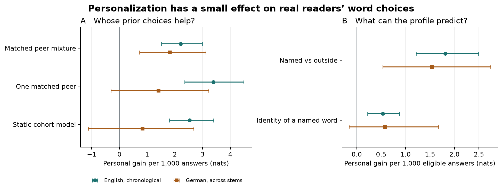

# Personal word-choice calibration transfers to independent German readers

A response-mode model predicted 9,602 actual completions from 98 German readers at 140 distinct written-only sentence beginnings. All learned German parameters came from 58,754 separately collected typed responses of 133 other people who heard sentence beginnings. A profile computed from the target person's responses on shared, disjoint materials gained 0.00182 nats per answer over profiles averaged across equally informed reading peers (95% crossed reader-by-sentence interval 0.00073–0.00312). The advantage was positive for 62.2% of individuals. The mean geometric probability assigned to their observed answer rose by about 0.18%. This prospectively registered transfer concerns the calibration of lexical choices in a new cohort and language. [Registered test](muse-protocol.md) · [Original MuSe study](https://doi.org/10.3758/s13428-026-02993-3) · [Full estimates](../results/reading-validation-muse/independent-reading-scores.json)

| Source and prediction condition | Negative log probability, nats per answer | Gain with the correct person's history | 95% crossed interval for gain |
| --- | ---: | ---: | ---: |
| Native Qwen German word-mass projection | 3.08427 | | |
| Four-parameter human-calibrated native mass | 2.87740 | | |
| Frozen response-mode distribution for an unknown person | 2.86744 | .00083 | −.00112 to .00268 |
| One other reader with the same number of observed choices | 2.86802 | .00141 | −.00031 to .00322 |
| Full mixture of equally informed other readers | 2.86843 | .00182 | .00073 to .00312 |
| Target person's cross-item response profile | **2.86661** | | |

Source and target populations were identified from the original anonymized identifier prefixes exactly as specified by the source authors. The released cleaned tables yield 386 visually presented stems, 479 auditory stems and 246 shared stems. The article describes 385 and 480 presentations. All 140 targets in the primary analysis were visually presented stems which occur nowhere in the auditory cohort. All 98 new readers had enough shared-stem observations for inclusion and the median size of the matched personal sample was 223. None of these calibration answers concerned a written-only target. With only twenty observations for each reader the gain over the experience-matched pool was .00077 nats (.00011–.00156); comparisons with one stranger and the fixed auditory prior had intervals spanning zero. The public cleaned trial table does not include item presentation timestamps or order. This is an independent cross-item test. The English experiment provides the separate evidence for genuinely later responses. [Original data and cohort codes](https://osf.io/ktnze/) · [Locked materials](../results/reading-validation-muse/exposure-seal.json) · [Personal forecasts fixed before access to held readings](../results/reading-validation-muse/human-forecast-lock.json) · [English chronological study](reader-history-results.md)

The independently selected German lexicon contains 4,096 named words or transliteration categories from German wordfreq 3.1.1. It covers 5,731 mutually disjoint complete native leading-space token encodings across lower- and initial-upper-case spellings. Five categories join spellings that the authors’ transliteration convention renders identical. The remaining category accommodates choices outside this alphabet. A named Qwen token can itself begin a longer German compound. Source normalization and model-fitting used genuine responses; each full stem needed one forward regardless of the number of observers. The German dictionary covered 4,730 of 9,602 held responses (49.3%). The correct profile gained .00154 nats per answer for the inside/outside decision (.00053–.00274) and .00058 nats per named choice for its actual spelling (−.00016–.00168). The latter advantage was not established. A positive mixture of powers preserves the relative ordering of named words. The model's personal effect is therefore a confidence adjustment for lexical prediction and cannot identify a different favorite spelling for each person. [Converged auditory-source model](../results/reading-validation-muse/auditory-fit.json) · [All named/outside comparisons](../results/reading-validation-muse/independent-reading-scores.json)

The 619 original German sentence beginnings were encoded in 20 length-batched forward passes, with three separate single-sentence numerical controls. All participant identifiers, demographics and health-related fields were absent from the accelerator packet. Its 140 written-only answer columns stayed unavailable to fitting; the numerical personal and control weights were hashed before extracting them locally from the public release. Pairwise learning used 13,202,436 source response pairs for the class decision and 3,147,928 pairs for named spellings. The German source estimated dependence .0946 for the class decision and .0133 for named spellings. This is a transfer of the English-derived method with new auditory-source German parameters. [Independent source and protocol](muse-protocol.md) · [Fixed native stimuli and vocabulary hashes](../results/reading-validation-muse/exposure-seal.json)

**Figure 1.** Positive values in panel A indicate a higher probability assigned to observed responses using the target person's history. The controls are the equal-history group, one matched individual and the frozen cohort prior. Panel B decomposes the gain over the equal-history group. The named-word row uses named choices as its denominator. English observations come from 219 individuals’ chronologically later pages. The 98 German participants contributed disjoint conditioning and held material, with within-study time order unavailable. Bars show 95% intervals from resampling both participants and sentence contexts. [Vector figure](../results/reading-validation-reader-history/reader-history-cross-cohort.pdf)
