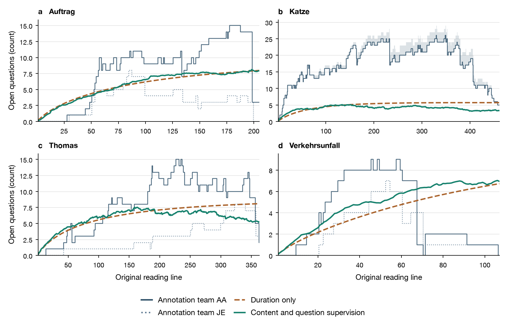

# A line-by-line test of the proposed unresolved-question curve

Four complete German stories have line-level annotations of when a specific plot question is open or resolved. They let us evaluate the proposed state more directly than a reading-time proxy. A model trained on three stories estimated an opening rate for every line of the fourth. A separate hazard model estimated when each such opening would resolve. At every line, the model's expected outstanding count equals its previous count plus new openings minus closures. No question, known source or closing location is provided for the held story. Each story passes through Qwen once. [Original data](https://osf.io/m524v/) · [Protocol](narrative-survival-protocol.md) · [Likelihood](narrative-survival-estimator.md)

| Reading question on the held story | Duration only | Word form and overlap | Native context | Context plus source-trained question wording |
| --- | ---: | ---: | ---: | ---: |
| Given two active questions at a closure, choose the one that closes | 70.8% | 67.0% | 65.5% | 65.5% |
| Given a closure line, locate its opening among all earlier lines | 7.0% | 5.9% | 6.6% | 6.6% |
| Negative log probability of the observed lifetime | 4.66 | 5.02 | 5.05 | 5.04 |
| Squared error outside the observed open-count interval | 54.27 | 57.89 | 62.86 | 61.49 |
| Average precision for jointly locating an opening and its exact closing line, without a cue | .0045 | .0097 | .0106 | .0118 |

Estimates give each original story equal weight. Two annotation teams supplied 222 question records in seven story-by-team observations. Of those records, 202 had exact closure lines, six had interval closures and fourteen were still unclosed when observation ended. A line can introduce more than one question; candidate pairs with the same opening and closing line collapse to one location opportunity for retrieval. Averaged over stories and then annotation teams within story, 0.11% of admissible line pairs were exact openings and closures. Semantic supervision raised precision above elapsed duration for this sparse retrieval endpoint, but its top-ranked pair matched no exact event in any of the four stories. Its lifetime likelihood and count error were worse. The observed stock sometimes rises and falls substantially while the forecast changes only modestly. [Every held story and comparison](../results/reading-validation-narrative-survival/scores.json) · [Forecast and censoring geometry](../results/reading-validation-narrative-survival/forecast/seal.json)

The two blue lines show the count of definitely open questions according to each contributing annotation team. A shaded interval also includes provisionally open questions. The vertical range follows the observed counts in each story. Model curves use only the visible article. The gold dashed curve uses elapsed duration; the green curve includes content and indirect supervision from the training stories' question descriptions. Readers' independent continuous suspense ratings were evaluated separately in the same four texts. More than 450,000 word-aligned suspense measurements increase measurement precision within a story; the independent story count remains four. [Vector figure](../results/reading-validation-narrative-survival/open-questions.pdf) · [Original-line source data](../results/reading-validation-narrative-survival/open-questions.csv) · [Human suspense](narrative-course-results.md)
