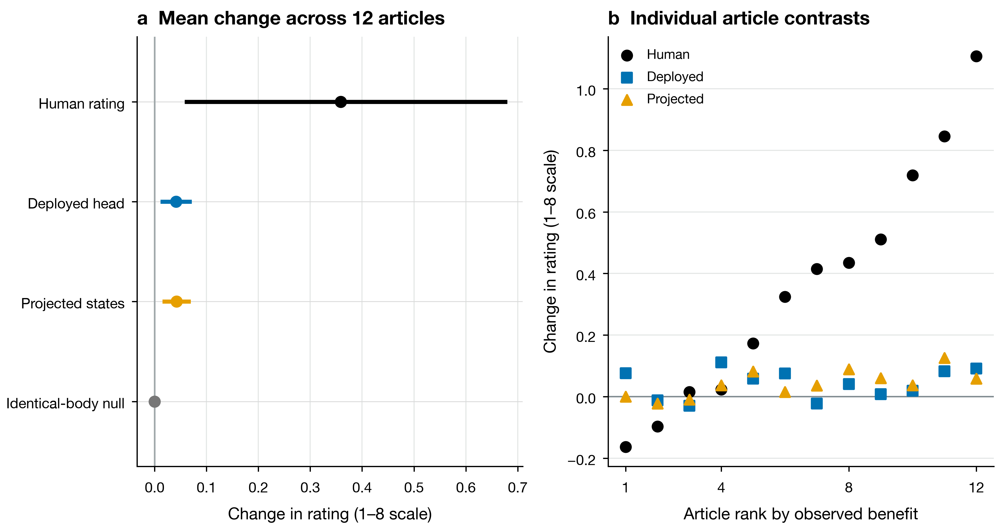

# Section headings improved readers’ ratings more than the deployed model predicted

Adding section headings to otherwise matched English plain-language research summaries improved university students’ perceived comprehensibility by **0.359 points on an eight-point scale**. The deployed CogLLM understanding head predicted a **0.042-point** improvement. Its positive average response captured about 12% of the observed mean benefit. The point estimate was essentially the same as that of the earlier 32-dimensional observer. [Original reader study](https://doi.org/10.1525/collabra.18898) · [Scoring data and uncertainty](../results/reading-validation-local/native-headings/scores.json)

| Heading minus no heading | Change on the 1–8 scale | 95% interval |
|---|---:|---:|
| Human article rating | +0.359 | +0.062 to +0.676 |
| Deployed head using the full 2,048-dimensional terminal state | +0.042 | +0.015 to +0.067 |
| Historical projected observer | +0.042 | +0.019 to +0.066 |
| Identical printed body, scored without preceding context | 0.000 | 0.000 to 0.000 |
| Deployed prediction minus observed benefit | −0.317 | −0.628 to −0.018 |
| Deployed prediction minus historical projected prediction | −0.001 | −0.027 to +0.028 |

The 166 participants supplied 1,283 article ratings in these two conditions across 12 research summaries. In the original paper’s mixed model the headings improved perceived comprehensibility by 0.352 points (SE 0.081, p < .001). Our 0.359-point estimate weights articles equally and uses their observed arm means. Ten of the 12 articles had a positive observed difference. The deployed observer matched the direction for nine articles. Always predicting an improvement matched ten. Mean absolute article-level error was 0.386 for the deployed head, 0.358 for the projected observer and 0.402 for the identical-body control. The deployed head’s error reduction relative to the control was 0.016 points (95% interval −0.022 to +0.056). [Paper, Table 4](https://doi.org/10.1525/collabra.18898) · [All 12 article contrasts](../results/reading-validation-local/native-headings/scores.json)

The frozen Qwen3.5-2B encoder processed each of the 24 original presentations in one forward pass on an L4. The normal deployed sentence observer received all heading text and preceding sentences, plus the pre-established Unicode boundaries of the matched body sentences. All 362 stops had exact prefix-token alignment. Each of the 181 matched pairs contained the same literal sentence and had a different article prefix. No Kerwer grades entered estimation or model selection. We averaged the medical PLABA-trained expected understanding score equally over matched sentences within each presentation and converted each difference from 1–5 to 1–8 by multiplying by 7/4. This linear scale correspondence is an assumption. The 10,000 crossed bootstrap draws resampled participant and source article independently. The individual-article plot shows descriptive estimates, including their sampling noise. [Registered design](native-heading-protocol.md) · [Native GPU receipt](../results/reading-validation-local/native-headings/receipt.json) · [Prediction at each original stop](../results/reading-validation-local/native-headings/native-headings.jsonl) · [Printable figure](../results/reading-validation-local/native-headings/heading-benefit.pdf)

This previously examined experiment tests whether a sentence-level observer responds to explanatory structure when the local body wording is held fixed. Readers rated the entire summary. Their responses establish an article-level benefit and leave open which heading helped, whether it helped at its first word, and whether another ordering of the same explanations would have a similar effect. The added headings also changed text length, positions and discourse cues together. [Original experimental design](https://doi.org/10.1525/collabra.18898)

A follow-up used Kerwer’s article ratings to fit one visible-heading term while holding out articles and readers. It recovered more of the mean intervention effect and performed similarly to a rule that only reads the heading template. [Article-level adjustment and disjoint test](heading-adaptation-results.md)
