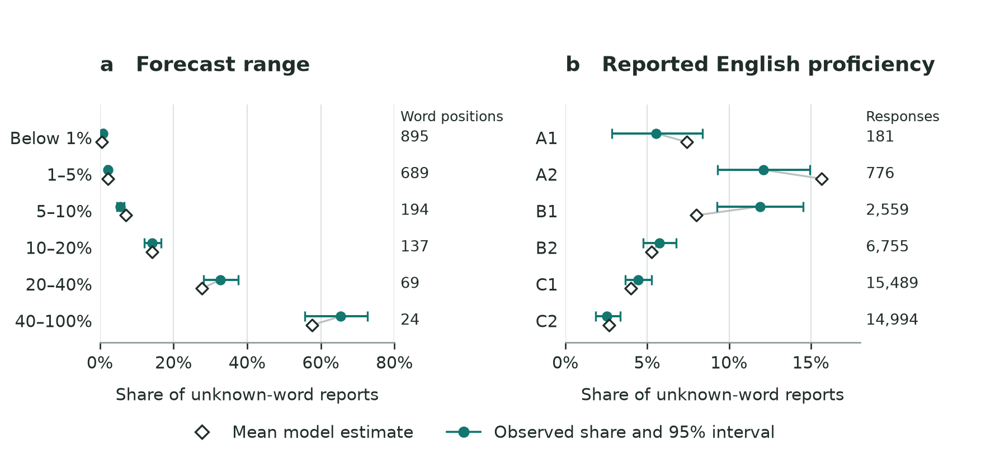

# How to read the percentage above an English word

For words given a 10–20% score by the pooled learner model, the average forecast was **14.1%** and the observed share of unknown-word reports was **14.2%**. At higher scores, the model tended to understate the observed rate. For words scored at 20–40%, it predicted 27.7% and readers marked 32.7%, a difference of 5.0 percentage points (95% interval 0.4–9.8). The percentages can distinguish several levels of risk in this study. Their precision varies by score and by proficiency group. [Source study](https://aclanthology.org/C16-1069/) · [Analysis plan](nns-calibration-protocol.md) · [Numerical results](../results/reading-validation-nns/calibration/source-data.csv)

| Displayed risk, before rounding | Judged word positions | Reader responses | Predicted | Observed | Observed minus predicted, percentage points (95% interval) |
| --- | ---: | ---: | ---: | ---: | ---: |
| Below 1% | 895 | 18,141 | 0.50% | 0.85% | +0.35 (0.10, 0.63) |
| 1–5% | 689 | 13,939 | 2.23% | 2.09% | −0.14 (−0.53, 0.30) |
| 5–10% | 194 | 3,953 | 7.02% | 5.54% | −1.48 (−2.44, −0.45) |
| 10–20% | 137 | 2,780 | 14.11% | 14.17% | +0.06 (−2.09, 2.40) |
| 20–40% | 69 | 1,425 | 27.67% | 32.70% | +5.03 (0.41, 9.77) |
| 40–100% | 24 | 516 | 57.55% | 65.31% | +7.76 (−4.85, 20.85) |

Across 40,754 observed responses the mean prediction was 4.32% and the observed rate was 4.57%. This is a retrospective audit of already released forecasts over 200 held English sentences, with equal weight per recorded response. Intervals come from 10,000 resamples of complete sentence families. Across 4,742 scorable printed words, 2,008 had an aligned, designated survey response. In the highest score range, readers had evaluated 24 of 86 scorable words, across 18 sentence families. The calibration table applies to the designated words where the outcome is known. The source archive has no persistent respondent identifier, limiting inference about new readers. [Training, response selection and open-word bounds](nns-results.md) · [Counts and coverage in all bins and cohorts](../results/reading-validation-nns/calibration/scores.json)

Self-reported proficiency improved average held response loss, although its probability error varied across groups. For A2 the model predicted 15.64% unknown versus 12.11% observed, and for B1 it predicted 7.99% versus 11.88%. B2, C1 and C2 each had at least 6,755 responses, with observed versus predicted average rates within half a percentage point. A1 had 181 responses from 20 materials. The release lacks enough marked outcomes to promise precise A1 probabilities. The displayed intervals describe each stratum individually. No refitting or revision of the deployed numerical scores used this audit. [Original proficiency comparison](nns-results.md) · [Analysis code](nns_calibration.py)

The circles show the share of actual unknown-word reports. Whiskers resample complete held material families 10,000 times. Open diamonds show mean predicted probabilities for the same responses. Panel a uses the pooled model and labels the number of distinct judged word positions. Panel b uses the specified proficiency and reports the number of individual responses. Both panels reuse the same 40,754 judgments. [Vector figure](../results/reading-validation-nns/calibration/reported-word-difficulty.pdf) · [Numerical source data](../results/reading-validation-nns/calibration/source-data.csv)
