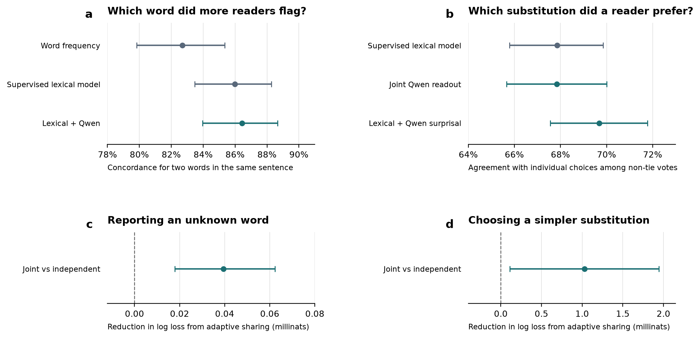

# Sharing supervision between an unknown-word report and a simpler substitution

A shared readout of Qwen3.5-2B reduced held probability loss on two directly reported reading behaviors. One group of English learners marked words they could not understand. Another group compared alternative words in the same sentence and could explicitly tie them. For identical available features, sharing reduced mean response log loss by **0.0000394 nats** on word reports (95% interval 0.0000178–0.0000623) and **0.001029 nats** on revision preferences (0.000112–0.001944). Both prespecified lower bounds exceed zero. These are small gains relative to independent losses of 0.13958 and 1.00450. A calibrated native word-predictability control gave the best absolute revision result. [Original study](https://aclanthology.org/C16-1069/) · [Locked likelihoods and tests](nns-rewrite-protocol.md) · [Complete scores](../results/reading-validation-nns-rewrite/scores.json)

| Held outcome | Independent Qwen | Adaptively shared Qwen | Strong reference |
| --- | ---: | ---: | ---: |
| Word-report log loss (nats), 40,754 judgments | 0.13958 | 0.13954 | 0.13900, learned lexical model |
| Revision log loss (nats), 7,335 choices including ties | 1.00450 | 1.00347 | 0.98737, lexical features plus Qwen surprisal |
| Agreement with an individual non-tie revision vote | 67.80% | 67.84% | 69.68%, lexical features plus Qwen surprisal |
| Agreement with panel majority, excluding tied vote counts | 73.19% | 73.14% | 75.18%, lexical features plus Qwen surprisal |

The sharing coefficient came exclusively from four disjoint training-family folds. It was 0.154 for the contextual word model and 1.000 for revision preferences. Each observation used its own likelihood. The word model fitted a binomial count and a prevalence intercept. The revision model fitted two opposing word-difficulty differences and a free tie intercept with a three-class Davidson likelihood. A quadratic coupling penalized differences between their slopes. All twenty fitted arms converged with a maximum absolute gradient below 0.0000007. The 591 revision training families supplied 13,665 actual votes over 2,676 distinct pairs. The remaining 296 material families supplied 7,335 votes over 1,454 pairs, including 2,070 ties. Agreement between two randomly sampled actual people on the three-way response was 46.11% (44.46–47.78%). We give the conditional non-tie rates separately from the main likelihood that retains all ties. [Training, coefficients and extraction receipts](../results/reading-validation-nns-rewrite/forecast-seal.json)

Adding native probabilities to the lexical comparator reduced revised-word response loss by 0.01610 nats versus the shared contextual model (0.00655–0.02585) and improved agreement with individual non-tie votes by 1.85 percentage points (0.04–3.67). This control used the exact frozen Qwen probability of the substituted word in its preceding context and the probabilities of up to three following printed words, from the same model pass. The raw probability of the word alone agreed with 68.94% of individual votes and 75.21% of majority preferences. An earlier word-report-only model applied directly to this task agreed with 64.85% of individual votes. Training on real substitution judgments raised that agreement by 2.99 percentage points (1.05–4.96). [Prospectively added native-probability comparison](nns-rewrite-reference.md) · [Source data for the figure](../results/reading-validation-nns-rewrite/direct-reader-responses.csv)

Each rendered sentence was evaluated in one causal pass, including all inspected alternative word boundaries. The contextual and lexical arms use equal material-family weights, identical source and held partitions, and the same penalty with and without sharing. A separate lexical-only sharing test yielded no word gain and a small uncertain negative revision result. The authors screened alternatives for grammatical and semantic suitability before eliciting preferences. Extrapolation to an arbitrary author rewrite, information preservation, or an individual reader's online cognitive-load curve requires other observations. [Original materials and overlap](../results/reading-validation-nns-rewrite/material.json) · [Separate held word-localization study](nns-results.md)

Panels a and b show reader-response agreement under the registered definitions. Panels c and d report the change in proper log loss when the two behavioral likelihoods share parameters. Each bottom panel uses its own horizontal scale. Their whiskers represent 10,000 paired material-family bootstrap resamples; panel a covers 179 ordering-informative sentences and panel b covers 296 independent revision families. [Vector PDF](../results/reading-validation-nns-rewrite/direct-reader-responses.pdf)

The original ZIP and the published predictions reproduce both joint-training gains and all four confidence limits in a stand-alone NumPy calculation. [Command and source archive](nns-results.md) · [Exact replication receipt](../results/reading-validation-nns/public-replay.json)
