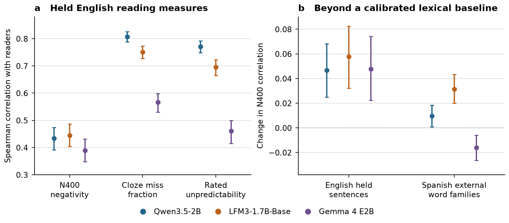

# Three small causal models generalize differently across human reading measures

All three models’ contextual states improved the held English N400 prediction beyond the same model’s calibrated print-and-word-surprisal comparator. The size of this advantage changed when the fixed English heads were applied to recorded Spanish reading. LFM3 retained the largest contextual advantage. Gemma’s contextual head scored below its own surface comparator in Spanish. Each original text was evaluated once with each fixed backbone, using the same visible printed words and the same supervision. [Registered comparison](physiology-portability-protocol.md) · [All paired estimates](../results/reading-validation-physiology-portability/english-spanish-scores.json)

**Figure 1.** The left panel shows Spearman correlations of independently refitted contextual readouts with 1,546 held word positions across 186 English sentences. The right shows the paired difference from that encoder’s trained print-and-surprisal head. The Spanish assessment contains 8,640 word contexts across 299 lexical families. Intervals resample entire English sentences or Spanish families. The English training and Spanish transfer cohorts were distinct. Each backbone saw 824 complete stimulus texts covering 14,834 certified word ends, with three additional technical suffix-removal checks. [Vector figure](../results/reading-validation-physiology-portability/human-response-transfer.pdf) · [Model and word-alignment record](../results/reading-validation-physiology-portability/input-seal.json)

| Fixed native backbone | English N400 | English cloze miss fraction | English rated unpredictability | Spanish N400 | Spanish contextual gain over trained baseline |
| --- | ---: | ---: | ---: | ---: | ---: |
| Qwen3.5-2B | .433 | .807 | .771 | .182 | +.010 [.001, .018] |
| LFM3-1.7B-Base | .445 | .750 | .695 | .199 | +.032 [.020, .043] |
| Gemma 4 E2B | .389 | .567 | .460 | .176 | −.016 [−.026, −.006] |

The observations co-located at the English words came from separate participant groups. The count model used 121,722 observed completions recovered from the original response workbooks. Intervals for the English contextual N400 gain were .025–.068 for Qwen, .032–.082 for LFM and .022–.074 for Gemma. Changes from calibrated comparators for cloze and explicit ratings varied across encoders. At the public Spanish exposures, raw Qwen, LFM and Gemma word surprisal correlated with reader negativity at .095, .097 and .080, respectively. Comparing a calibrated contextual readout with both raw and trained controls reveals a different picture of transfer. [Source units and questionnaire audit](cloze-observation-audit.md) · [English stimuli](https://doi.org/10.3758/s13428-023-02261-8) · [Spanish words and electrophysiology](https://doi.org/10.1016/j.isci.2026.117159)

The frozen English-trained readouts also predicted a larger group difference at the following noun than at the preceding article in a separate, nine-laboratory English experiment. Across 334 participants, the unexpected-minus-expected human negativity magnitude was 0.200 µV at the article and 1.602 µV at the noun. Of 51,692 released voltage rows, 51,554 had verified material and word identity, covering 80 matched families. Correlations with the 80 family-specific noun effects were .453 for Qwen, .314 for LFM and .138 for Gemma. At the article the corresponding values were .027, .152 and −.008. Capturing the rough mean location was easier than predicting which particular noun manipulation mattered most. Each model produced a positive noun–article contrast under family resampling. The Qwen contextual-minus-surface gain in item-level noun rank correlation was .098 (95% paired interval −.020–.182). The independent sample supports a difference between word positions and leaves this incremental readout advantage uncertain. [Nine-lab score record](../results/reading-validation-physiology-portability/scores.json) · [Paired differences and simultaneous intervals](../results/reading-validation-multilab/paired-readout-differences.json) · [Experimental source and trial reconciliation](multilab-word-results.md)
