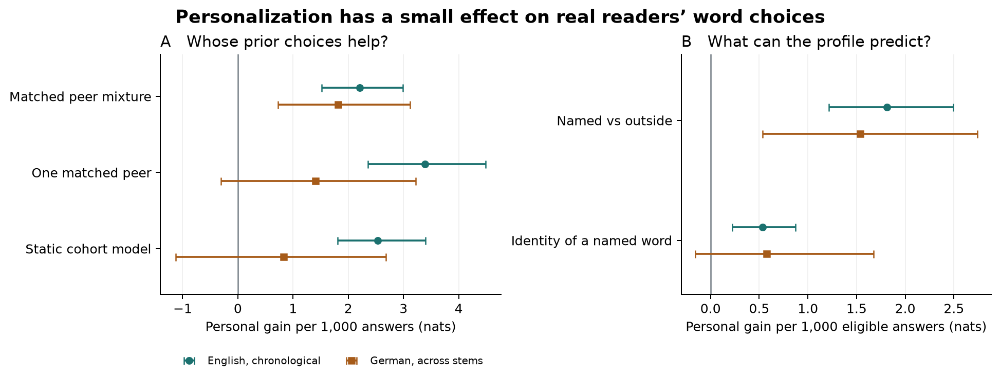

# What twenty earlier word choices reveal about a reader

The same frozen English Qwen observer can give a word-choice distribution for an unknown reader and condition that distribution on twenty earlier completions by an observed person. In a new public sample, 233 identifiable readers produced 297,927 genuine later responses to 3,085 sentence beginnings. Their earlier answers improved mean log loss from 3.564 to 3.435 nats per later response. A different reader's history from similar material also improved it to 3.444. The incremental benefit of the correct person's history was 0.009 nats (95% reader-by-sentence interval −0.007–0.026). The external accuracy gain concerns calibration to a new study population, with substantial uncertainty about personal specificity. [Forecast lock](../results/reading-validation-reader-history/external-lock.json) · [Full results](../results/reading-validation-reader-history/external-scores.json) · [Original independent study](https://doi.org/10.3758/s13428-020-01351-1)

| Human choices and comparator | Choices | Fixed unknown-reader loss | Correct earlier-history loss | Other reader’s history loss | Paired gain over other history, nats |
| --- | ---: | ---: | ---: | ---: | ---: |
| UCL, material and questionnaire records held out | 34,304 | 3.894 | 3.868 | 3.919 | .0517 [.0366, .0686] |
| Independent study, verifiably later assignments | 297,927 | 3.564 | 3.435 | 3.444 | .0092 [−.0074, .0257] |
| Independent study, other items on a single page | 1,604 | 3.667 | 3.532 | 3.551 | .0194 [−.0143, .0566] |

The model estimated a distribution over 49 response types from source questionnaires. The two axes capture how sharply a reader concentrates choices on probable spellings and how often their answer falls outside the fixed lexicon of 8,192 named alternatives. Each new sentence was encoded once, and reader conditioning used the resulting word distribution. All six source fits satisfied the prespecified normalized stationarity criterion of 0.0000001. Source evaluation covered 159 held questionnaire records, 205 sentences and 1,726 word positions, separate from 471 fit forms. The eight original source workbooks replace recruitment IDs with one common placeholder. Repeated people across forms cannot be ruled out. The independent study instead supplies distinct anonymous participants with assignment acceptance and completion times. [Source fit and grouping](../results/reading-validation-reader-history/source-readers.json) · [Source predictive performance](../results/reading-validation-reader-history/source-scores.json) · [Reader-type model](reader-history-protocol.md)

Independent data came from the three original anonymized response files. Of 299,425 offered strictly later observations from eligible readers, 1,498 were empty and excluded. Thirty-six assignments that overlapped the first completed page were excluded; each future sentence stem had never appeared in that person's conditioning set. The average overlap in materials offered to the correctly assigned and other calibration readers was 97.0%. The separate one-page comparison has 62 participants, with unknown response order within each page. The model saw neither a person identifier nor any held answer when constructing its source forecasts. The new reader supplied only twenty measured choices. Their topical expertise was unmeasured. [Chronology rules](reader-history-chronology.md) · [Original response archive](https://github.com/jpeelle/sentence-prediction/tree/6bdd4426c35a76b2b1eecbe904d7277d061ea134)

The outside-lexicon rate rose from 6.0% in the source holdout to 25.3% in independent future answers. Of the independent 0.1293-nat gain over unknown history, .1265 came from predicting whether a spelling fell outside the fixed lexicon. Conditional on one of the 222,599 named responses, the gain in predicting its spelling was .0037 nats (−.0042–.0099). Own-history gain over other-history on these named choices was .00005 (−.0062–.0058). The corresponding named-word gain from own versus other history in the UCL source was .0403 (.0283–.0542). This decomposition limits how strongly a group-level completion response can be interpreted as a prediction about a specific person's expected word. [Prospective endpoint decomposition](reader-history-choice-content.md) · [Source estimates](../results/reading-validation-reader-history/source-choice-content.json) · [External estimates](../results/reading-validation-reader-history/external-scores.json)

## Retrospective peer calibration

A follow-up used 4,660 genuinely earlier responses observed in the new cohort to recalibrate the unknown-reader distribution. Each training split excluded all held people and sentence folds. It estimated outside-lexicon propensity and named-word concentration separately, with no later answers available for fitting. All 25 crossed fits converged, with maximum normalized gradient 0.000000064. The resulting unknown-reader prior achieved loss 3.2864. Conditioning on one's own twenty answers yielded 3.2926; the matched stranger yielded 3.2983. The own-versus-stranger gain was .00570 nats (.00225–.00919), including .00401 nats per named choice (.00019–.00804). The unknown-reader cohort prior still outperformed the twenty-answer personal profile by .00620 nats (.00422–.00840). A well-calibrated group prior is a substantive baseline for personalization. This reanalysis used a previously evaluated cohort after discovering a marked between-study shift; it requires independent replication. [Registered follow-up](reader-history-target-prior.md) · [Fitted prior lock](../results/reading-validation-reader-history/peer-prior-lock.json) · [All comparisons](../results/reading-validation-reader-history/peer-scores.json)

Using more history exposed a distinct modeling failure. A second analysis used every available response from a previously submitted questionnaire, then withheld the full tested sentence fold from all histories. It covered 284,385 choices from 219 people; the median matched history comprised 412 choices (range 20–2,404). A person's fixed latent-type posterior gained .0120 nats per answer (.0084–.0159) over one other reader with the same number of observations, yet lost .0070 (.0049–.0092) to a population mixture at the same experience level. The relevant control averaged 17–232 other readers. For the class decision alone, personal history gained .00115 nats (.00017–.00230). Its exact named-word prediction lost .01090 nats per named answer (.00870–.01331). A history model that becomes confident about one permanent response type can discard useful variation within one reader. [Original timestamp and material safeguards](reader-history-sequential.md) · [Experience-matched estimates and all observation bands](../results/reading-validation-reader-history/sequential-scores.json)

As a raw-data check, the reconstructed most frequent choice agreed with the authors’ published modal answer within the release precision at all 3,085 external stems. The published proportions use two decimal places. At 3,083 stems every reconstructed spelling proportion agreed within the half-unit rounding allowance (0.005 for one reported spelling). Three of 57,674 stem–spelling cells exceeded the allowance, and two observed answers had spellings absent from the published summary. The maximum discrepancy was one percentage point. All personal analyses used the original anonymized ballots and the authors' documented corrections. [Raw-versus-published reconciliation](../results/reading-validation-reader-history/external-response-count-audit.json)

## Allowing a reader to alternate between response modes

A person can favor a common option on one trial and a more unusual option on the next. A hierarchical mixture represents each person's tendency to alternate between these response modes. It estimates the degree of between-reader variation from pairs of first-page answers by other people. Across the 25 source splits, the median fitted within-person dependence parameter was .177 for the named-versus-outside decision and .086 for concentration among named words. The estimator required no held answers to set either shrinkage strength. No feature or individual update changed the single-pass language encoder. [Registered response-mode model](reader-history-mode-mixture.md) · [Fitted priors, convergence and variation by fold](../results/reading-validation-reader-history/mode-prior-lock.json)

On the same 284,385 genuine later answers, the new model achieved 3.28350 nats per response. The equally experienced population mixture achieved 3.28571, the static peer prior 3.28603 and the matched stranger 3.28689. Correct personal history gained .00221 nats (.00152–.00299) against the strongest experience-matched population, about 0.22% in geometric mean assigned probability. The gain was positive for 64.8% of the 219 readers. Its components were .00181 nats per answer (.00122–.00249) for the outside decision and .00053 per named choice (.00022–.00087) for the exact spelling conditional on the named category. This identifies a small reader-specific contribution under repeated observations in this population. The analysis followed inspection of the earlier models' errors, making independent replication essential. [All controls and experience bands](../results/reading-validation-reader-history/mode-scores.json)

All named-word temperature modes preserve the same conditional ranking within a sentence. They can alter a word’s predicted probability, or the relative mass of the open residual category, while keeping the same favorite named spelling for every reader. German investigators’ independent visual and auditory samples provide a separate check of this response-mode procedure, including that limitation. [Registered German replication and estimates](muse-results.md)

**Figure 1.** Correctly assigning observed history improves the probability of subsequent English choices relative to a pool of people with matched experience. The German test uses disjoint calibration and target stems. The open class absorbs words outside each language's prespecified dictionary. [Vector figure and axes](../results/reading-validation-reader-history/reader-history-cross-cohort.pdf)

An additional, source-trained frequency preference can order two spellings differently for two readers. It changed the favorite word at 1,312 of 212,395 named English responses and at none of 4,730 named German responses. The English improvement in getting the favorite right was 0.029 percentage points, with an interval spanning zero. These results delimit the behavioral evidence for predicting a particular reader's chosen word. [Choice ranking, strong control and intervals](reader-frequency-rank-results.md)

A separate simulation generated answers from a known within-person mixture. The model estimated a dependence of .277 for a generating value of .25. The first posterior mean and the zero-dependence limit agreed with their analytical values within 0.00000003. The simulation used 400 artificial training and 300 held participants. These are numerical checks on the implementation. The prose term “patient comparisons” in the archived protocol denotes *paired comparisons* of research participants with equal amounts of observed history. [Simulation and exact enumeration](../results/reading-validation-reader-history/mechanism-verification.json) · [Original analysis protocol](reader-history-mode-mixture.md)
