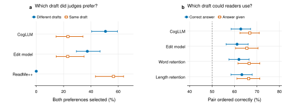

# Do readers answer more questions correctly on the revisions CogLLM favors?

Without seeing the question, a frozen CogLLM score for meaning preservation assigned a higher value to the revision whose reader gave the correct answer in **62.8%** of informative comparisons [95% interval 58.5, 67.2]. When comparing the version where the reader gave an answer with a version where the reader said information was insufficient, the same score reached **66.8%** [62.5, 71.0]. Preserving the original's word count reached 63.3% and 66.3%, respectively. The study supplies direct evidence relating a text score to reader behavior. The accuracy gain over the registered strong controls remains unestablished. [Registered analysis](revision-comprehension-protocol.md) · [Numerical results](../results/reading-validation-comprehension/scores.json)



[Vector figure](../results/reading-validation-comprehension/figure/revision-judgments-and-comprehension.pdf) · [Caption and denominators](../results/reading-validation-comprehension/figure/caption.md) · [Numerical source data for the figure](../results/reading-validation-comprehension/figure/source-data.csv)

## The reading experiment

Agrawal and Carpuat recruited 112 native English speakers. Each task included six paragraphs in one experimental condition and three questions per paragraph. The 60 OneStopQA paragraphs came from 30 articles. The eleven conditions comprised an advanced original, a human-written elementary version and nine automatic simplifications. Participants selected an option or indicated the supplied paragraph contained insufficient information. The authors released 660 paragraph presentations and 1,980 question responses. One participant judged each presented paragraph version. An informative comparison here therefore contrasts the recorded answers of people who saw different drafts. Questions and choices never enter the passage predictor. [Original TACL article](https://aclanthology.org/2024.tacl-1.24/) · [Pinned authors’ data release](https://github.com/sweta20/ATS-EVAL/tree/c59328ab111b59e954763707b1051cf34feeead6)

For the primary test we compared pairs of revisions of the same paragraph on the same question. We averaged concordance within each question, paragraph and article in turn. Higher means that the score selected the draft with the observed favorable response more often. The 10,000 paired bootstrap draws resample articles. The table has no stable participant IDs, so uncertainty in repeated observations of the same participant across articles cannot be estimated separately. The public table contains two duplicate paragraph–system assignments and two absent assignments. We excluded the two ambiguous assignments from the primary test after discovering them in the text-only geometry. Averaging their repeated responses instead gave 62.9% and 66.8%. [Registration and data amendment](revision-comprehension-protocol.md) · [Data geometry and exclusions](../results/reading-validation-comprehension/input-seal.json)

| Score over the original and a revision | Correct answer | Answer supplied |
| --- | ---: | ---: |
| Frozen meaning-preservation head | 62.8% | 66.8% |
| Trained form and lexical editing model, meaning head | 61.1% | 65.5% |
| Original word retention, weighted by frequency | 62.0% | 66.5% |
| Word count closest to the original | 63.3% | 66.3% |
| Frozen simplicity-preference head | 44.8% | 45.5% |
| Higher estimated absolute ease from ReadMe++ | 44.7% | 41.8% |
| Fewer words | 35.3% | 32.5% |
| Informative model comparisons | 3,281 | 2,517 |
| Informative question IDs | 176 / 180 | 157 / 180 |

For correctness, the paired differences for the meaning head were +1.7 percentage points [−0.4, 3.8] over the trained editing model, +0.8 [−1.1, 2.7] over word retention, and −0.5 [−4.0, 3.9] relative to retained length. The registered criterion required positive lower bounds for all three. The meaning head did distinguish this response from a simplicity judgment: it outperformed reusing the frozen simplicity-preference score by 18.0 points [11.8, 24.4]. The corresponding differences for explicit answer availability were +1.3 [−0.5, 3.4], +0.3 [−1.7, 2.5] and +0.5 [−2.9, 4.4] against the three registered controls. A paragraph can be rated easier while omitting information needed for a particular test question. [All paired effects](../results/reading-validation-comprehension/scores.json)

## Comparisons with the actual original and with identical text

The advanced original had observed human answers. Against a revision with a different observed answer to the same question, CogLLM selected the version yielding a correct answer in 75.6% [69.0, 81.8] of 651 comparisons, and the version yielding an answer in 84.0% [77.7, 89.6] of 481 comparisons. The retained-length control reached 76.9% and 85.2%. For this particular comparison the original always retains its own length and wording. Its readers’ answers help explain why this is a strong benchmark. [Original-to-revision estimates](../results/reading-validation-comprehension/scores.json)

Five pairs of different experimental conditions presented byte-identical text with the same three questions. Across the resulting fifteen question pairs, the recorded correctness outcomes differed six times and reported availability differed five times. The frozen model gave identical scores for each pair of identical texts. Five articles do not establish a population-wide human performance ceiling. They illustrate the variation a deterministic passage score leaves unexplained when people read exactly the same paragraph. [Measurement plan](revision-comprehension-repeat.md) · [Observed repeated presentations](../results/reading-validation-comprehension/identical-texts.json)

## Model, independence and reproduction

The frozen Qwen and lexical coefficients were inherited from the SimpDA experiment. The external inference code exactly reproduced eight previously recorded estimates for all 360 SimpDA candidate rows before opening the ATS response values. The prior study’s participants rated whole-draft simplicity, preservation and fluency. The new study's participants provided actual answers. No component was trained or selected on the new answer outcomes. Comparing the ATS materials against the actual supervised inputs of CompLex, the absolute reading head and the revision estimator retained all 30 article families. All 30 share a twelve-word sequence with material in the historical portable reader's OneStopQA packet (23 training, seven development). Those portable-reader weights contribute no features to this evaluation. The ATS panel is a separate human study with previously seen source material in the broader project. The original Qwen pretraining corpus cannot be audited exhaustively. [Analysis lock](../results/reading-validation-comprehension/analysis-lock.json) · [Surface-overlap audit](../results/reading-validation-comprehension/input-seal.json) · [Earlier-forecast numerical replay](../results/reading-validation-comprehension/replay.json)

On an NVIDIA L4, 653 unique paragraph strings containing 89,443 Qwen tokens and 70,550 aligned words were encoded in 41 batches in 39.6 seconds. Each passage was encoded once, with six separate technical verification passes. Source texts were reused when scoring multiple drafts. The model could not see the test, the answer or what others had chosen. We did not observe readers’ timing or the token where they lost the information. [Sealed prediction and extraction record](../results/reading-validation-comprehension/forecast-seal.json) · [Forecast implementation](revision_comprehension_forecast.py)

Using the same public files and cache layout as the previous revision experiment, fetch the authors' pinned CSV into `.cache/cogllm/reading-validation/revision/ats_eval.csv`. From the repository root, a scratch copy can reproduce the following sequence. The CPU environment used NumPy 2.5.5, SciPy 1.17.1, NLTK 3.10.4 and wordfreq 3.1.1. On Colab the existing revision extractor reads the outcome-free packet and its sibling lexical coefficients. Researchers may also reuse the checksummed native feature archives named in the run receipts.

```sh
python -m research.reading_validation.revision_comprehension_prepare
python -m research.reading_validation.revision_comprehension_forecast --archive /path/to/original/revision-forecast --verify-original .cache/cogllm/reading-validation/revision/stimuli.jsonl
python -m research.reading_validation.revision_comprehension_forecast --archive /path/to/ats-comprehension-forecast
python -m research.reading_validation.revision_comprehension_score
python -m research.reading_validation.revision_comprehension_repeat
python -m research.reading_validation.revision_figure
```
