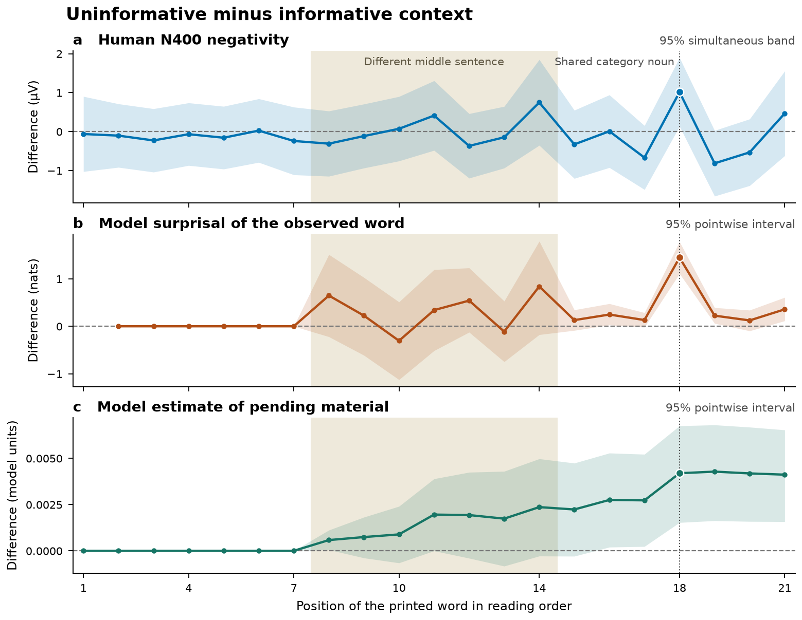

# The word at which a semantic clue changes reading

An unfamiliar Spanish term appeared as the seventh word of a three-sentence passage. Readers then saw either an informative explanation or an unrelated continuation. The same category noun appeared at word 18. The original study recorded the electrical response to each word and later asked readers to select the meaning of the term. We recovered the actual printed words and verified the timing of every sampled event against the participant's presentation log. This produced 112 lexical families with identical first and third sentences, 45 readers with choices, and 43 with complete EEG recordings. [Original study](https://doi.org/10.1016/j.isci.2026.117159) · [Public human data](https://doi.org/10.17605/OSF.IO/AVY4W) · [Registered behavioral study](spanish-clue-protocol.md) · [Registered physiology](spanish-eeg-protocol.md)

*Only the common category noun at word 18 had a reliable EEG difference across the 21-position simultaneous band. The shaded middle sentence changed between conditions. Lines show the uninformative minus informative contrast for the same 112 target families. The two model panels show pointwise uncertainty over families. The first observed word lacks prior-token surprisal. Positive differences are expressed in each panel’s labeled units.* [Vector figure](../results/reading-validation-spanish-clues/semantic-reading-course.pdf)

**The model and human readers distinguished the two continuations at the common category word.** Qwen's unprompted whole-word surprisal fell by 1.447 nats after informative context (target-family bootstrap 95% interval 1.108–1.782). The direction held for 88 of 112 families. When both articles had exactly the same total native-token length, the difference was 1.473 nats (0.660–2.274; 26 families). The category onset also gained 1.594 logits (1.301–1.885) relative to other available categories. A static cumulative embedding control showed a cosine change of 0.003 (−0.004–0.010) on its own scale. Later words had negligible numerical effect on the common prefix. [Paired word estimates](../results/reading-validation-spanish-clues/cue-scores.json)

**Independent human recordings localize a condition difference to word 18.** In the 300–500 ms N400 window, less informative context increased the negativity at that word by 1.016 µV. The 95% interval was 0.465–1.605 across families and 0.572–1.463 across readers. The paired family randomization gave one-sided p=0.00025. Word 18 was the only point whose simultaneous 95% band across all 21 words excluded zero (0.13–1.90 µV). The common word at position 7 and the early 100–200 ms interval at word 18 both included zero. The stricter artifact screen gave 1.015 µV. Of 130,032 word epochs, 127,954 passed the primary automatic rule. The original authors used manual ICA; our prespecified independent pipeline uses baseline correction, mastoid rereferencing, a seven-electrode mean and fixed rejection thresholds. [Extraction and provenance](../results/reading-validation-spanish-clues/eeg-extraction.json) · [Voltage, word and reader intervals](../results/reading-validation-spanish-clues/eeg-scores.json)

**The size of each family's physiological effect remains uncertain.** The correlation between the model's paired category surprisal difference and each family's N400 difference was 0.115 (family interval −0.078–0.287, reader interval −0.047–0.215). The generic unresolved curve rose less in informative text by 0.00236 at the end of the explanatory sentence (−0.00028–0.00497) and by 0.00412 at passage end (0.00158–0.00653), in model units. The condition-level agreement at the later noun establishes a specific timing and direction under this manipulation. It leaves open when a particular person understood the novel word. [Model time courses](../results/reading-validation-spanish-clues/cue-scores.json) · [Item-level physiological estimates](../results/reading-validation-spanish-clues/eeg-scores.json)

**Matching the model to actual response probabilities required human supervision.** The primary analysis linked 3,535 choices over 122 pseudowords to a unique earlier exposure and an independent glossary entry. A scalar-calibrated one-pass next-token readout yielded choice log loss 1.368, versus 1.386 for uniform guesses, 1.323 for training-only alternative frequency plus position, and 1.235 for a condition oracle given the correct answer. The simple frequency comparator's advantage was present across both words and readers. Within each condition, model probability of the correct answer correlated 0.007 or 0.161 with the fraction of people selecting it. The answer-readout template was appended after the unmodified article in the same causal forward. The raw article's states remained invariant in prefix checks. [Primary choice estimates and Holm tests](../results/reading-validation-spanish-clues/choice-scores.json) · [Scoring implementation lock](../results/reading-validation-spanish-clues/scoring-lock.json)

A separately registered follow-up trained choice probabilities on the observed relative option scores across six successive prefixes together with training-only answer preferences. In a crossed word-and-reader holdout, it reduced loss from 1.308 to 1.266. Grouped improvement was 0.0432 (0.0196–0.0648) by word and 0.0427 (0.0258–0.0584) by reader. These outcomes informed the method change. On 179 previously excluded decisions concerning eight new words, its loss was 1.289 against 1.341. The reader interval for improvement excluded zero, while the interval across the eight words was −0.018–0.158. This analysis used the same original experiment and separately held out every evaluated participant from fitting. [Follow-up registration](spanish-choice-joint-protocol.md) · [Choice reductions and fitted coefficients](../results/reading-validation-spanish-clues/choice-joint-scores.json)

We recovered the remaining original answer alternatives and froze the fitted coefficients before extending the same experiment. Across 630 decisions on 22 additional words, the semantic model scored 1.272 nats per choice and the frequency-and-position model scored 1.372. Fourteen word families had never been scored, including during the eight-word follow-up. For these 420 decisions, loss was 1.276 versus 1.383. The mean advantage was 0.107 nats by word (95% interval 0.078–0.137) and 0.106 by participant (0.071–0.139). All 45 evaluated readers remained outside their respective fitting folds. The new word families establish a replication within this experiment. [Frozen-vocabulary expansion](spanish-card-expansion.md) · [Word and participant estimates](../results/reading-validation-spanish-clues/card-expansion-scores.json)

The average word-18 N400 effect was reproducible across readers, but the ranking of individual word families varied substantially. Across 2,000 random participant splits, the median cross-half correlation of the 112 family-specific condition effects was 0.016. Its central 95% split range was −0.122 to 0.167. The appropriate physiological claim here concerns the group’s response at the common word. Individual-word variability offers limited precision for evaluating a prediction of who understood which term. [Participant-split reliability](../results/reading-validation-spanish-clues/eeg-item-reliability.json)
