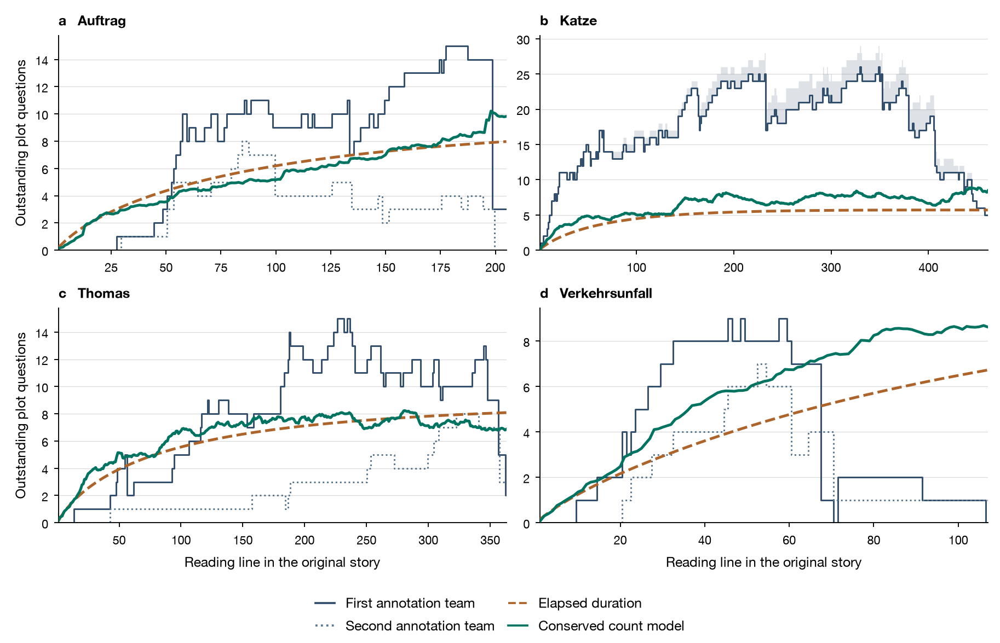

# How well does a one-pass reader recover the number of unanswered plot questions?

A model that trained directly on the observed count of outstanding questions lowered mean held-story squared error from 53.45 to 47.80, with each of four German stories receiving equal weight. The elapsed-duration model scored 54.27. The count improvement over elapsed duration came entirely from *Katze*. On the three other stories the elapsed-duration forecast had lower error. In *Verkehrsunfall*, annotators closed nearly all their remaining questions as an event unfolded; the estimated count continued to climb. These four trajectories provide a direct test of the proposed curve and identify a failure that a single mean obscures. [Original human study](https://doi.org/10.1017/langcog.2025.10057) · [Count and survival observation model](stock-process-protocol.md) · [All forecasts and grades](../results/reading-validation-stock-process/scores.json)

| Held original | Elapsed duration | Two lifetimes | Two lifetimes with count supervision | Count and independent suspense supervision |
| --- | ---: | ---: | ---: | ---: |
| Auftrag | 13.03 | 14.58 | 14.40 | 14.40 |
| Katze | 179.84 | 170.98 | 142.62 | 142.63 |
| Thomas | 12.26 | 14.00 | 14.16 | 14.16 |
| Verkehrsunfall | 11.95 | 14.23 | 20.01 | 20.01 |

Entries give squared error outside the interval permitted by each team's annotation, in questions squared. Exact opening, subsequent survival, interval closure and right censoring supervise different parts of the process. It conserves outstanding mass at every line. The source has 222 annotated questions, of which 202 closed at a known line, over 1,136 reading lines. We rotated the intact story that was excluded from all fitting. The four stories already informed earlier development. Statistical replication requires additional originals, and these intervals describe annotators' questions about the plot. [Numerical convergence and sealed forecasts](../results/reading-validation-stock-process/forecast/seal.json)

The dark and dotted blue steps show counts from the two contributing annotation teams; shaded areas include questions marked provisionally open. The green curve uses the text and direct count supervision. The dashed brown curve uses elapsed duration. Every predicted curve uses the preceding and current text only, with one native encoder pass per complete article. The raw plotting data include the openings and closures that add to the green curve at each reading line. [Printable figure](../results/reading-validation-stock-process/human-and-estimated-questions.pdf) · [Line-level counts and attributed changes](../results/reading-validation-stock-process/human-and-estimated-questions.csv)

Count supervision recovered the direction of a determinate change in 66.0% of cases, versus 65.4% for elapsed duration. Given a real closure and two active questions, it chose the one that closed 63.7% of the time versus 70.8% by elapsed duration. Given the closing line, it placed a correct opening first among all earlier lines on 7.6% versus 7.0%. Joint training on 457,494 word-aligned suspense ratings changed count error by 0.0013 questions squared and left the story-level conclusion unchanged. On line-to-line changes in suspense, mean within-story rank correlation was only .087. The count, the identity of the outstanding question and readers' suspense remain independently gradable outcomes. [Original lifetime and uncued-retrieval results](narrative-survival-results.md) · [Direct human suspense and agreement](narrative-course-results.md)
