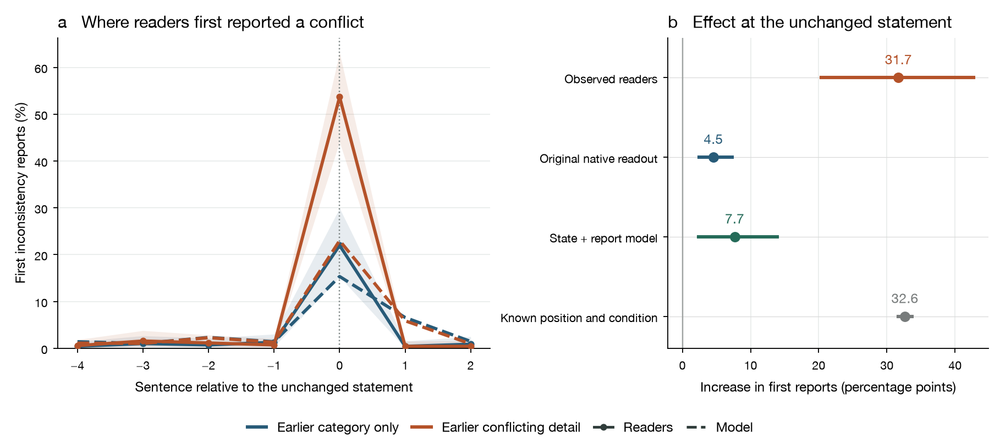

# Remembering a noun and noticing a contradiction are different measurements

Readers can regard a cello as an instrument while distinguishing it from an oboe. We fitted directional category judgments to 11,534 actual 0–6 ratings of 982 noun pairs in HyperLex. The held lexical split had 198 noun pairs, 2,332 ratings, and no word shared with the training pairs. Adding directional WordNet ancestry raised correlation with the human mean from .581 to .729 and reduced negative log likelihood of the individual ratings from 1.667 to 1.548 nats. The decrease was .118 nats per vote [.088, .149] in a bootstrap over word pairs. The model used the source's individual answers, with no category-relation label supplied as a predictor. [Primary study](https://aclanthology.org/J17-4004/) · [Registered transfer](taxonomic-premise-protocol.md) · [Human lexical ratings and scores](../results/reading-validation-taxonomic-premise/lexical-test.json)

We then asked which earlier noun and which current noun a reader could compare in a story. Comparing authors' matched experimental versions identifies admissible training pairs. The held article itself is unmarked. The highest-scoring pair found the source noun and the affected later word jointly in 15 of 22 identifiable retained variants across the twelve held story families. On those variants the mean mass on the designated earlier sentence was .855 and the mass on the designated current word was .798. Those results concern a human-authored manipulation, with the target sentence given for this particular localization diagnostic. [Per-story alternatives and correct source spans](../results/reading-validation-taxonomic-premise/story-forecast/fits.json)

At the unchanged later sentence, the older risk calibration predicted condition effects of 2.8 percentage points with symmetric similarity, 4.4 points with directional category judgments and 3.1 points with additional native evidence. Real readers increased their first inconsistency reports by 32.1 points in Experiment 2 and 31.7 points in Experiment 3. The authors reused the same twelve story families across those two cohorts. Correctly representing a noun relation did not recover the human effect magnitude. [Human paths and competing models](../results/reading-validation-taxonomic-premise/story-scores.json)

## A calibration change reduces premature alerts

The prior loss gave the target sentence extra weight. We replaced that term with a model of how many actual readers were still at risk of their first report in each sentence. We learned separate report hazards for ordinary sentences, neutral specifications and conflicting statements. The article-only predictor averages those hazards using its estimated state probabilities. The held story family is absent from all training and the final cohort contributes no training responses. [Risk-set model and interpretation](premise-emission-protocol.md)

| Experiment 3, 233 readers and 12 stories | Predicted increase at the unchanged target | Observed full-response-path loss, nats ↓ | Excess probability of a premature report in the neutral version |
| --- | ---: | ---: | ---: |
| Human first report | 31.7 pp [20.4, 42.7] | — | — |
| Original frozen semantic readout | 4.5 pp | 1.674 | 14.5 pp |
| Risk-set model using location | 0.0 pp | 1.686 | 8.1 pp |
| Risk-set model with symmetric similarity | 4.9 pp | 1.507 | 2.7 pp |
| Risk-set model with human-calibrated directional categories | 7.7 pp | 1.502 | 3.0 pp |
| Risk-set model plus causal native word features | 5.7 pp | 1.469 | 2.3 pp |
| Diagnostic given the true target and condition | 32.6 pp | 1.303 | −0.8 pp |

The native risk-set readout improved the independent cohort's full-path loss by .205 nats [.063, .347] relative to the original. The near match in the last row is informative about *where* the pipeline loses the effect. The human response rates from other families are sufficiently large to reproduce an effect of this order when the state is supplied. Identifying that state confidently from the article remains difficult. Even the oracle missed the registered equivalence criterion requiring the entire discrepancy interval within ten points. Positive trajectory likelihood and lower premature reporting can coexist with a large underestimate at the critical sentence. [All estimates, two crossed reader and story intervals](../results/reading-validation-premise-emission/scores.json)

Sentence zero is identical in the two conditions. The human curves separate there. The directional risk-set estimate reproduces a smaller separation. The right panel compares the condition difference, including a diagnostic supplied with the true critical sentence and condition. [Vector figure](../results/reading-validation-premise-emission/first-report-trajectory.pdf) · [Original-unit plot data and crossed intervals](../results/reading-validation-premise-emission/first-report-trajectory.csv)
