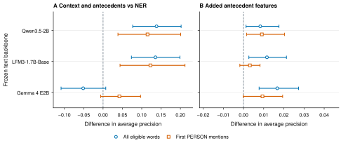

# Two of three backbones reproduce the character-introduction result

Qwen3.5-2B and LFM3-1.7B-Base ranked the words readers marked as unexplained character references more accurately than a pretrained named-entity (NER) and part-of-speech control with each model’s native word surprisal. The gain persisted when comparing only first mentions that the NER model had already identified as people. Gemma 4 E2B did not satisfy the prespecified replication criterion. With identical words and matched feature counts, its average precision (AP) was 0.607 against its control’s 0.659. The continuous word map has replicated on two architectures on the same known English narrative benchmark. [Protocol](transition-architecture-protocol.md) · [Full results](../results/reading-validation-transition-architecture/scores.json)

## External movie forecasts

All three candidates read the same 149 complete summaries. The model-specific token sequences ended at identical original Unicode coordinates on all 89,231 word ends. No additional text or word was lost between architectures. During training, labels came from two summaries for each of 44 book titles; 11 further book titles supplied development thresholds. The external set contained 39 movie summaries, with 22,133 unambiguously labeled words, including 413 reader-marked words. The first-PERSON comparison includes 302 words, 194 marked. All intervals below use 10,000 paired resamples of complete movies. The original Qwen results on these movies were already known at study registration. [Common items](../results/reading-validation-transition-architecture/common-support.json) · [Source and label mapping](transition-snac-protocol.md)

| Frozen backbone | All-word AP | NER control AP | All-word AP gain, 95% interval | First-PERSON AP | First-PERSON gain over NER, 95% interval |
| --- | ---: | ---: | --- | ---: | --- |
| Qwen3.5-2B | 0.801 | 0.663 | +0.138 [0.077, 0.202] | 0.934 | +0.115 [0.039, 0.201] |
| LFM3-1.7B-Base | 0.812 | 0.676 | +0.135 [0.073, 0.199] | 0.953 | +0.122 [0.044, 0.212] |
| Gemma 4 E2B | 0.607 | 0.659 | −0.051 [−0.109, 0.007] | 0.867 | +0.042 [−0.006, 0.097] |

LFM3's all-word advantage over Qwen was 0.010 [−0.011, 0.028]. Gemma’s larger native projection, which retains 64 coordinates per layer instead of the 48 matched across backbones, raised its AP to 0.641 [0.588, 0.696]. The fully preserved Gemma vector still ranked below its NER comparator by point estimate. The finding characterizes these specific projectors, checkpoints and book-trained observers. It cannot isolate the contribution of backbone architecture from the representation that the earlier projector retained. [Feature families and comparisons](transition_architecture_score.py)

Panel A compares the full causal word readout to a full-segment NER/POS model with source-calibrated word surprisal and text features. Panel B uses a word-local, equally causal scored state as its comparator. Points are matched-cohort AP differences. Bars show 95% paired movie-cluster intervals. The two panels have different numerical scales. [Vector figure](../results/reading-validation-transition-architecture/common-word-effects.pdf)

## What contributed to the ranking?

Appending 15 antecedent features to the current-word states raised AP by 0.008 [0.001, 0.018] for Qwen, 0.012 [0.003, 0.021] for LFM3 and 0.017 [0.008, 0.027] for Gemma. These features jointly describe hidden-state cosine similarity and native global attention to earlier words. The experiment estimates their combined predictive increment. The larger main gain on the two successful models came from the contextual word state. For the earlier production Qwen, the analogous antecedent increment was 0.005 [−0.003, 0.014]. [Production SNaC scores](transition-snac-results.md) · [Matched architecture estimates](../results/reading-validation-transition-architecture/scores.json)

The historical adaptive-joint Qwen preparation was also compared directly with the earlier two-endpoint Frick/ExpMRC preparation. The frozen architecture, human SNaC training examples, external words and source-only estimator fit were identical. Their all-word AP difference, adaptive minus two-endpoint, was −0.001 [−0.020, 0.018]; the first-PERSON difference was +0.006 [−0.009, 0.023]. The additional joint preparation did not establish a gain on this endpoint. [Comparison declared before re-extraction](transition-architecture-historical-comparison.md) · [Movie analysis](../results/reading-validation-transition-architecture/scores.json)

## Author-facing operating points and computation

At each model’s book-calibrated threshold, Qwen flagged 370 of 413 marked words and 663 of 21,720 unmarked words. LFM3 flagged 378 marked and 867 unmarked words. Gemma flagged 352 marked and 512 unmarked words. An author can therefore see more false alerts from a slightly better-ranked model if its source threshold transfers differently. [Thresholds, Brier scores, and movie-group uncertainty](../results/reading-validation-transition-architecture/scores.json)

The real Colab L4 required 149 whole-article scientific forwards per architecture, with two separate technical forwards per architecture on unrelated text. Extraction took 90.7 seconds for Qwen, 72.3 seconds for LFM3 and 102.5 seconds for Gemma after loading and verification. Their observed global attention layer counts were 6, 6 and 7. Independent replay of each official vocabulary head returned zero maximum absolute logit difference on the technical passage, including Gemma’s native final logit softcap of 30. Each source-fitted penalized binomial head met the prespecified gradient tolerance. A separate replay of all 26,417 historical movie words reproduced Qwen’s original local, antecedent and NER predictions exactly. [Qwen receipt and fitted weights](../results/reading-validation-transition-architecture/qwen-lock.json) · [LFM3 receipt](../results/reading-validation-transition-architecture/lfm3-lock.json) · [Gemma receipt](../results/reading-validation-transition-architecture/gemma4-lock.json) · [Production replay](../results/reading-validation-transition-architecture/common-head-replay.json)
