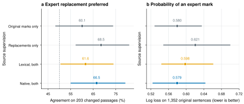

# One sentence score learns from expert marks and expert replacements

A writer's question is whether a proposed revision makes a sentence easier to connect to what precedes it. DECOR provides an observable action relevant to that question. An expert marked a problematic transition and proposed a replacement in the same context. We trained a shared risk score using two different losses. A judgment of an individual sentence constrained its absolute risk. A replacement constrained the difference in risk between two wordings of the same passage. Both losses used the same token-derived representation and started from a seven-reason observer trained on the original annotations. All material from the test topic, including its rewrites, stayed out of fitting and calibration in each of eight rotations. [Study design and source](transition-essay-rewrite-protocol.md)

| Which evidence updates the score? | Expert replacement gets lower risk | Choice log loss ↓ | Original mark log loss ↓ | Original mark AP ↑ |
|---|---:|---:|---:|---:|
| Frozen native essay observer | 61.1% | .642 | .580 | .554 |
| Native, original judgments only | 60.1% | .643 | .580 | .556 |
| Native, replacement choices only | 68.5% | .600 | .621 | .529 |
| Native, both | 66.5% | .622 | .579 | .559 |
| Lexical and surprisal, both | 61.6% | .637 | .598 | .508 |

Across 203 changed replacements from 75 essays, joint training favored the expert replacement 135 times. Relative to original-only training this is a gain of 6.4 percentage points [1.7, 14.9], with an original-judgment log-loss difference of −.00025 [−.01458, +.01167]. Relative to replacement-only training, the change in editing agreement was −2.0 points [−8.8, +5.4], and the joint model improved original-judgment loss by .0413 [.0148, .0746]. The precision of these comparisons does not establish equivalence. The underlying 1,352 original judgments included 446 marked sentences in 100 essays. Each of the 32 fitted source heads reached a maximum absolute gradient below 2 × 10⁻⁸. [Held predictions, fits and topic intervals](../results/reading-validation-transition-external/essay-cross-topic/expert-replacement-scores.json)

Against the matched joint lexical and surprisal head, the native joint readout improved editing agreement by 4.9 points [.8, 11.5], original-mark average precision by .051 [.014, .086], and original-mark log loss by .0184 [.0001, .0341]. The joint model favored 56 of 77 shorter, 49 of 78 equal-length and 30 of 48 longer replacements. The released data additionally contain nine unchanged wordings and one editing instruction. Giving unchanged wordings half credit yields 65.8% agreement on 212 text comparisons; the separate instruction has no revised sentence to read. The principal intervention is an expert's editing decision. Measuring whether another person prefers one replacement requires a separate judgment. [Independent evaluator protocol](transition-essay-human-choice-protocol.md) · [Source paper](https://aclanthology.org/2024.emnlp-main.639/)

The original DECOR publication reports class-frequency-weighted F1 for detecting a coherence problem. Matching this metric on the same 906 coherent and 446 incoherent originals, the joint CogLLM observer reached .657 [.597, .713] with a threshold selected on each separate topic to maximize weighted F1. Its original break-F1 threshold produced weighted F1 .620. The original paper reports .666 for GPT-4 zero-shot, .693 for GPT-4 16-shot, and .685 for DeBERTa-base trained on synthetic task judgments. Protocols differ in supervision, topic exposure, calibration and use of the written prompt. The original per-row systems' decisions would be needed for paired uncertainty against these published values. [Original Table 3](https://aclanthology.org/2024.emnlp-main.639.pdf) · [Matched metric and fold thresholds](../results/reading-validation-transition-external/essay-cross-topic/published-metric.json)

Each horizontal range is the 95% interval from paired resampling of topics and their original essays. The numerical differences in the text use the same draws across observers. [Vector figure](../results/reading-validation-transition-external/essay-cross-topic/essay-edit-tradeoff.pdf)

A subsequent experiment evaluated competing sentence replacements with a different expert. The positive original–replacement result did not extend to that decision. The joint observer agreed with 84 of 256 directional judgments between two rewrites. [Blind choice between alternative rewrites](transition-essay-human-choice-results.md)
