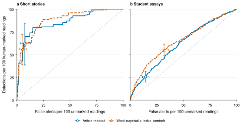

# Which sentence made the writing hard to follow?

A single pass over a short English story identified many sentences that readers subsequently marked as incoherent. Accuracy fell on student essays. Knowing which domain an author is writing in matters for interpreting a highlighted sentence.

## What readers actually did

CoheSentia participants read generated stories incrementally and marked coherence problems as each additional sentence appeared. We trained the probability of an individual reader marking the current sentence on 5,190 judgments from 346 stories, then set the alert threshold on 1,470 judgments from 87 disjoint stories. The public training partition contains 434 stories. One training story had no valid responses after excluding two raters with out-of-range sentence indices. The official test retained 49 complete stories and 293 noninitial sentence stops. The 770 individual judgments include 123 marks. In the independent DECOR study, experts judged whether each new sentence fit the preceding text in student-written English essays. We applied the story-trained weights and threshold to all 1,352 released contexts from 100 essays, with 446 incoherent and 906 coherent sentences. No DECOR labels were used for calibration. [CoheSentia methods](https://aclanthology.org/2023.emnlp-main.324/) · [DECOR methods](https://aclanthology.org/2024.emnlp-main.639/) · [Frozen design](transition-external-protocol.md) · [Outcome alignment](transition-external-alignment.md)

| Actual human outcome | Story, one reader at one sentence | Essay, one expert judgment per sentence |
| --- | ---: | ---: |
| Human marks among eligible observations | 123 / 770 (16.0%) | 446 / 1,352 (33.0%) |
| Average precision of raw-article readout | 0.618 [0.470, 0.774] | 0.451 [0.382, 0.519] |
| AUROC | 0.856 [0.776, 0.935] | 0.616 [0.574, 0.658] |
| Human marks detected | 77 / 123 (62.6%) | 114 / 446 (25.6%) |
| False alerts on unmarked readings | 48 / 647 (7.4%) | 131 / 906 (14.5%) |
| Fraction of alerts confirmed by a reader | 61.6% | 46.5% |
| Correct ordering of two sentences in the same document | 84.0% [72.9, 93.5], 23 eligible stories | 62.0% [57.7, 66.3], 92 eligible essays |

Brackets give paired 95% intervals from 10,000 whole-document bootstrap draws. Within-document ordering requires distinct sentences with a mark at one and a nonmark at the other, and weights eligible documents equally. Individual annotator identifiers in the public story data are local to each story. If at least half of a story's readers must agree, the raw model detected 28 of 45 marked boundaries and flagged 21 of 248 unmarked boundaries. A separate diagnostic used the other readers' judgments of the *same held-out sentence* to rank one reader's response. It reached AUROC 0.956 [0.930, 0.979] and AP 0.906 [0.849, 0.958]. The model has considerable room to approach this level of agreement. [All scores, resampling intervals and counts](../results/reading-validation-transition-external/scores.json)



Each curve sweeps the threshold after the scores have been frozen. Markers show the alert thresholds set from the separate story calibration partition, used unchanged on both tests. Whiskers are marginal 95% whole-document intervals for its sensitivity and false-alert rate. The diagonal marks chance ordering. [Vector PDF](../results/reading-validation-transition-external/reader-transition-operating-points.pdf) · [Figure code](transition_figures/operating_points.py)

## What carried across domains

| Predictor, evaluated on original text unless indicated | Story AP | Essay AP | Story Brier score ↓ | Essay Brier score ↓ |
| --- | ---: | ---: | ---: | ---: |
| Position, length and lexical overlap | 0.422 | 0.385 | — | — |
| Existing app transition and sentence position | 0.174 | 0.371 | — | — |
| Static Qwen content-word embeddings | 0.268 | 0.388 | — | — |
| Lexical controls plus contextual word surprisal | 0.630 | **0.503** | 0.089 | **0.209** |
| Causal current-sentence features | 0.657 | 0.472 | — | — |
| Primary integration readout | 0.618 | 0.451 | 0.090 | 0.238 |
| Same raw readout with a teacher in training | 0.616 | 0.474 | 0.089 | 0.220 |
| Separate prompted readout, one pass over formatted text | **0.678** | 0.475 | **0.086** | 0.215 |

The primary integration readout beat both preregistered controls on each corpus. Its story AP gains were +0.196 [0.056, 0.409] over lexical controls and +0.444 [0.275, 0.607] over the displayed transition. Corresponding essay improvements were +0.065 [0.004, 0.120] and +0.080 [0.013, 0.142]. Both AUROC intervals exclude chance. The stronger surprisal control tied the primary readout on stories (AP difference −0.012 [−0.107, 0.113]) and exceeded it on essays by 0.052 [0.006, 0.100]. These data support localizing some human-reported disruptions. They leave unresolved how much the explicit relation and previous-sentence representations contribute beyond ordinary language expectation. The older coherence readout transferred from Carter alone reached AP 0.450 on stories and 0.419 on essays and overflagged at its original threshold. [Carter study](transition-results.md)

The teacher supplied the equivalent weight of one expected reader judgment per training sentence. Its student retained a single raw-article inference pass. On essays it improved AP by 0.023 [0.012, 0.035] over the undistilled model and on stories the difference was −0.002 [−0.029, 0.022]. It detected 145 of 446 expert essay marks with 161 false alerts among 906 coherent sentences. The independent directed candidate supplied a fixed question and an empty response slot at every sentence, then read two logits without generating any text. Its essay threshold flagged 310 of the 906 coherent sentences, illustrating the limits of transporting a threshold across writing genres. [Distillation specification](transition-distillation-protocol.md) · [Directed-input design](transition-directed-protocol.md)

At the source-calibrated threshold the raw readout's weighted F1 on DECOR was 0.625. The paper reports 0.630 for BERT-base trained on an out-of-domain dataset and 0.693 for 16-shot GPT-4. Those thresholds and training regimes differ. Predictions also underestimated expert marks on essays. They averaged 0.217 versus the observed 0.330, with expected calibration error of 0.151 over ten fixed bins. On stories the corresponding values were 0.168 versus 0.160 and 0.064. The distilled student's essay calibration error was 0.101 and the surprisal control's 0.051. Scores displayed on a new author's essay warrant interpretation as *review priorities*. [Published DECOR comparison, Table 3](https://aclanthology.org/2024.emnlp-main.639.pdf) · [Independent label, ranking and calibration audit](../results/reading-validation-transition-external/calibration-audit.json)

In a post-primary diagnostic using every published reason category, the raw model flagged 17 of 112 expert-identified discourse relation problems on essays (15.2%, 95% interval 9.4–21.4%). It caught 7 of 41 semantic-connection problems and 82 of 236 tangential-relevance problems. Expert reason labels can overlap. These counts quantify why a broad improvement on mixed coherence judgments still leaves the detection of unusual logical turns far from complete. [All seven reason-specific results](../results/reading-validation-transition-external/reason-sensitivity.json)

## What happens when a human editor revises a sentence?

On all 213 released original–rewrite pairs, the raw integration model assigned less risk to the expert version 118 times, tied nine times and gave a higher value 86 times. Counting a tie as half a point gives 57.5% [51.0, 64.6]. The mean probability change was −0.014 [−0.028, −0.001]. Nine original/rewrite entries contained identical wording and one supplied an editing instruction. On the 203 actual changed replacements the model preferred 118, or 58.1% [51.3, 65.6]. The average change was −0.016 [−0.031, −0.003]. DECOR records the expert's intervention. It supplies no independent reader judgments after those edits. [Paired predictions and all comparisons](../results/reading-validation-transition-external/scores.json)

With the same earlier prompt markers in both versions of every pair, the separate directed candidate preferred 133 of the 203 changed sentences, or 65.5% [58.7, 72.7]. Its average score fell 0.049 [0.030, 0.069]. Across all 213 release pairs it preferred the changed passage 133 times, tied nine times and preferred the original 71 times. Every unchanged pair produced exactly equal scores. These results use 424 single-pass text records independently of the raw-article model. [Matched exposure checks and results](../results/reading-validation-transition-external/matched-scores.json)

The same text ending at the same sentence stop may occur in both a complete essay and a truncated copy. On nine unchanged edit fixtures the raw risk differed by at most 0.00000051. On a separate L4 replay of six real stories and essays, the public inference API reproduced 56 previously sealed predictions within 1.4 × 10⁻¹⁵. Twelve interventions replaced or truncated subsequent sentences while keeping earlier text fixed. Across the three raw-article scores the largest earlier change was 5.3 × 10⁻⁷. All 18 original or perturbed inputs required exactly 18 observed backbone calls. [Single-pass and prefix-invariance receipt](../results/reading-validation-transition-external/l4-serving-receipt.json)

The scoring API additionally compares tokenizer IDs at each completed sentence with IDs from its stand-alone prefix. It leaves a boundary unscored if that test fails. The study registers a separate complete pass for each raw article or prompted article. Six methods fitted on human stories and the secondary student solver converged in 5–8 Newton steps, with the largest final absolute gradient below 2.4 × 10⁻¹⁰. [Serving implementation](transition_inference.py) · [Weights and convergence histories](../results/reading-validation-transition-external/readouts.json) · [Prediction seal](../results/reading-validation-transition-external/prediction-lock.json)

CoheSentia and DECOR were public before the selected backbone was released. Their groups and expert labels were held out from this study’s supervised fitting as described above. The underlying model’s pretraining corpus cannot establish whether it encountered these materials. The uncertainty intervals condition on this fitted model and on the available annotators.

## Reproduction

Run the commands from the project root. The extraction in the transfer worker uses the selected Qwen3.5-2B joint readout and a single Colab L4. It observed 796 backbone calls per candidate for 796 complete articles and finished the feature extraction in 283 seconds. The matched edit comparison used 424 additional one-pass texts and took 94 seconds. Raw source texts and dated per-run tensors stay in the working cache.

```bash
python -m research.reading_validation.transition_external_source
python -m research.reading_validation.transition_external_prepare
python -m research.reading_validation.transition_static /path/to/pinned/Qwen3.5-2B/snapshot
python -m research.reading_validation.transition_external_fit --features /path/to/cohesion-forecast
python -m research.reading_validation.transition_external_score
python -m research.reading_validation.transition_calibration
```
