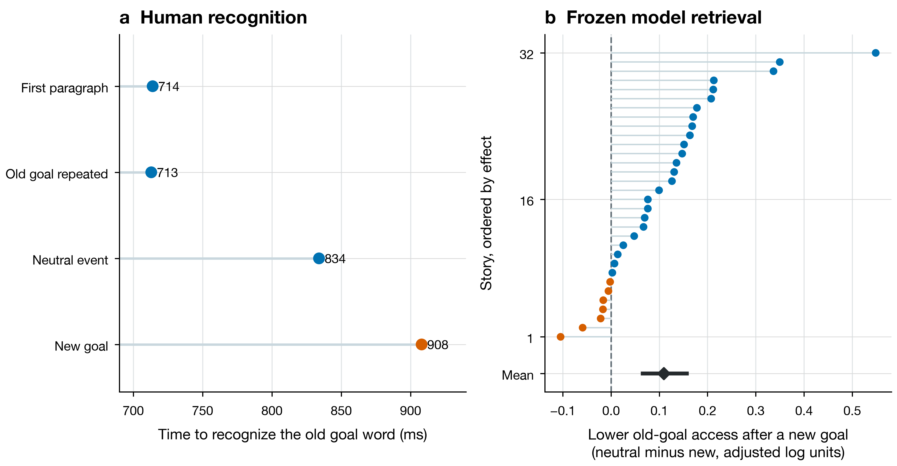

# A new story goal reduces later access to the original goal word

Across 32 stories in a controlled experiment, volunteer readers recognized a previously printed goal word more slowly after a character adopted a different goal than after an intervening neutral event. A frozen Qwen3.5-2B encoder gave less attention to the same word in the new-goal condition. This held after accounting for the age of the word and changes in three other equally old words. This comparison connects a change in model retrieval to a specific human memory judgment. The human study did not measure effort at each token. [Human experiment, Table 2](https://gernsbacherlab.org/wp-content/uploads/papers/Linderholm_Story_Character_Reading_DiscP_2004.pdf) · [Author-published narrative materials](https://gernsbacherlab.org/wp-content/uploads/2012/12/goalsupp.pdf)

| Opportunity to recognize the old word | Human mean correct recognition latency, ms | Frozen Qwen accessibility, log units | Trained CogLLM unresolved mass assigned to that word |
|---|---:|---:|---:|
| End of the first paragraph | 714 | .2924 | .00736 |
| Following an original-goal remention | 713 | .6238 | .00696 |
| Following neutral material | 834 | .0010 | .00465 |
| Following a new goal | 908 | −.1056 | .00430 |

**Figure 1.** Human points are the published condition means. Each model point represents one original story after recency and control-word adjustment. The diamond and bar show the mean and 95% story-bootstrap interval. [Vector figure](../results/reading-validation-transition-goal-access/goal-accessibility.pdf)

The original study retained 84 of 110 participants. The printed old-goal probe and the sentence immediately before it were identical across the three versions of each story. The recognition trials required a yes/no decision about whether a test word had appeared, with old-goal and distractor probes in the experimental design. The model saw the natural text through each opportunity, up to and including the shared sentence, without a probe, question or condition marker in its input. The human new-minus-neutral contrast was 74 ms, with published participant and item statistics of F(1,83) = 28.15 and F(1,31) = 20.86. Approximate 95% confidence intervals reconstructed from these statistics and rounded group means are 46.3–101.7 ms by participant and 41.0–107.0 ms by item. Participant and item latencies were unavailable for individual-level comparisons. The models' numeric scales therefore have separate columns. [Original recognition experiment](https://gernsbacherlab.org/wp-content/uploads/papers/Linderholm_Story_Character_Reading_DiscP_2004.pdf) · [Registered model analysis](transition-goal-access-protocol.md)

The frozen model's statistic averages native attention from the final subtoken of each lexical word in the common sentence to all earlier printed occurrences of the probe. It averages within the subtokens of each occurrence and scales by the number of preceding word opportunities before taking the logarithm. Neutral events yielded .1065 more log units of old-goal accessibility than new goals (95% story-bootstrap interval .0549–.1605, 24 of 32 stories). Uniform selection predicted a zero change. Inverse-distance recency predicted .0501. The within-story difference beyond recency was .0564 (.0038–.1118). After subtracting the average of three introductory control words matched for occurrence count, location and length, the native advantage over recency was .1094 (.0659–.1570), positive in 25 of 32 stories. The trained CogLLM anchored unresolved score also fell after a new goal. Its probe-minus-control change was .000252 (.000126–.000413), with no independent conversion from that magnitude to subjective load. [Native contrasts and per-condition results](../results/reading-validation-transition-goal-access/scores.json)

Remention versus neutral raised raw native accessibility by .6228 (.5365–.7115). Thirty-one stories reprinted the exact probe in the remention. When retrieval was restricted to the original introduction, the remention advantage was .0140 (−.0327–.0639). No reprinted probe occurred in either neutral or new-goal manipulations, so the latter comparison was unaffected. The equal human means after the introduction and after remention also show a mismatch with the model's elevated raw remention score. These distinctions matter when applying the effect to an author who may have repeated a phrase or changed the subject. [All original-location sensitivity estimates](../results/reading-validation-transition-goal-access/scores.json)

After the registered results were known, we checked whether lexical similarities could explain the new-goal effect. Among the 26 stories with no WordNet synonym or direct hypernym, hyponym or similar-to neighbor of the old probe in either manipulation, the control- and recency-adjusted difference was .0960 (.0543–.1385). Ten stories gave neutral material no greater content-word overlap with the original goal sentence than new material; the estimate was .1175 (.0216–.2337). The intersection included eight stories, with a difference of .0804 (.0039–.1486). WordNet any-sense matches include incidental readings and cannot exclude all thematic associations. These small subgroups are a secondary robustness check. [Lexical sensitivity, criteria and all item assignments](../results/reading-validation-transition-goal-access/lexical-sensitivity.json)

We encoded all 96 originals on an L4 in 8.03 seconds, one causal forward per version. The identical first paragraph produced identical token IDs within all 32 triplets. Across raw and control-word scores, the greatest variation on the same prefix was 0.00000142. The extraction script recovers all 32 story IDs and both original word-probe opportunities from the publicly supplied materials. The numerical archive contains model scores and hashes. The original stimulus wording is available from the authors' supplement. [Exposure and source hashes](../results/reading-validation-transition-goal-access/exposure-seal.json) · [Downloadable model item scores](../results/reading-validation-transition-goal-access/model-item-scores.npz)

Other human experiments distinguish forgetting a superseded goal from keeping an unresolved person accessible. Gerrig, Love and McKoon found faster recognition of a newly introduced name when the person's relation to the story remained unexplained. Love and colleagues independently reproduced this qualitative pattern with trait versus role information and found slower recognition of a word following the mystery introduction. Their 2010 experiments reported a 33 ms name advantage and a 44 ms downstream-word disadvantage. The opposite directions for different probes motivate distinct latent quantities for unresolved information and accessibility of its referent. Those studies were not used to fit or evaluate the scores reported above. [Gerrig et al., 2009](https://pmc.ncbi.nlm.nih.gov/articles/PMC2701237/) · [Love et al., 2010](https://pmc.ncbi.nlm.nih.gov/articles/PMC2864939/)
