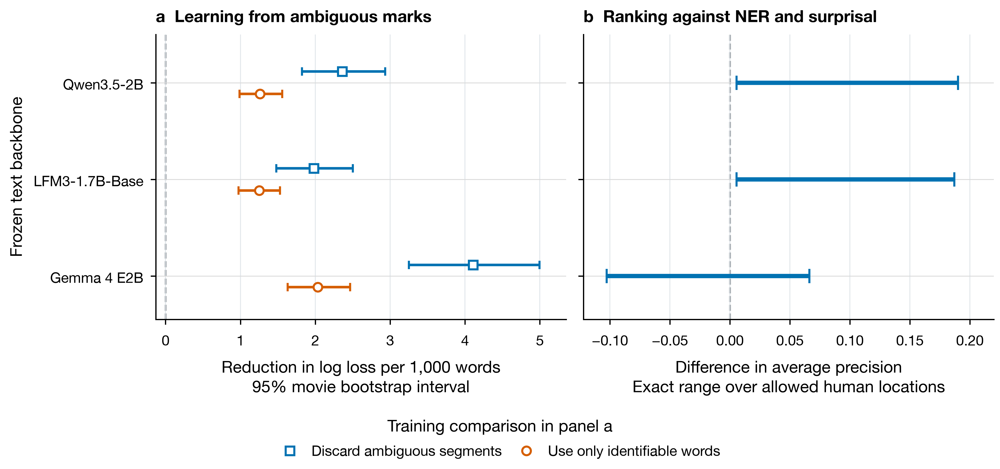

# Human span ambiguity can supervise a causal word detector

When readers highlighted a character name that appeared several times in the same annotation segment, the public record retained its text without a unique location. We trained a word readout to assign probability to the entire set of compatible human choices. This uses the information that at least one eligible occurrence was selected and that words outside those occurrences were unmarked. The detector still reads each original article once. On the 39 held-out movies the source-trained, ambiguity-aware Qwen readout reduced the mean negative log probability of the observed human annotation per word from .03707 to .03524. The decrease occurred in 36 movies; the paired change was −.00183 [−.00236, −.00132], approximately 4.9% of the original loss. The comparison used identical features, capacity, book-title weighting and ridge penalty. [Registered measurement and optimization](transition-partial-loss-protocol.md) · [Full scores](../results/reading-validation-transition-partial/scores.json)

| Supervision supplied on the 44 training book titles | Contributing source words | Held-out observable-set NLL per word | AP at identifiable movie word locations |
|---|---:|---:|---:|
| Only fully identifiable segments | 43,103 | .03707 | .8013 |
| Individually identifiable words from all segments | 50,862 | .03634 | .8125 |
| Exact marginal likelihood of the observed annotation set | 51,309 | .03524 | .8160 |

A total of 134 training segments had multiple compatible word masks. Relative to retaining every individually identifiable word, integrating over the remaining alternatives reduced the held-out loss in 37 of 39 movies (−.00110 per word). AP increased by .00355 [.0010, .0065]. Relative to dropping those whole segments, the AP increase was .01471 [.0078, .0221]. Both independent initializations converged to the same source objective within 10⁻¹⁵, and the largest external logit discrepancy was 2.12 × 10⁻⁷. The final gradient was below 3 × 10⁻⁹. These new loss comparisons reuse an already studied movie collection. [Source-only fits, convergence and paired intervals](../results/reading-validation-transition-partial/scores.json)

Across **all 26,417 words**, the improved Qwen head beat the strong NER-plus-surprisal comparator in average precision for every jointly admissible placement of the released character annotations. The sharp AP difference ranged from +.01025 to +.19553. Its matched whole-segment-discarding fit was worse under every placement by .00452 to .01884. The comparison with retaining every identified individual word ranged from −.00391 to +.00913. These ranges locate the effects on this fixed sample under the public source constraints. They differ from the movie bootstrap sampling intervals above. [Exact paired extrema and replayed witnesses](../results/reading-validation-transition-partial/identification.json)

## Same loss across three frozen architectures

The cross-architecture experiment used 128 matched input coordinates per word. All architectures saw the same books, human annotation sets and movie words. The Qwen row here uses the separately fitted historical cross-architecture projector. The writer uses the original production Qwen projector evaluated above. [Replication protocol](transition-partial-replication-protocol.md)

| Backbone | Full observable-set NLL, discarded → marginal | Movies improved | AP on identified-segment words, discarded → marginal | Exact full-word AP advantage of marginal over its architecture’s NER plus surprisal |
|---|---:|---:|---:|---:|
| Qwen3.5-2B | .03841 → .03605 | 37/39 | .8006 → .8162 | +.0056 to +.1901 |
| LFM3-1.7B-Base | .03842 → .03643 | 38/39 | .8123 → .8283 | +.0055 to +.1870 |
| Gemma 4 E2B | .05621 → .05210 | 37/39 | .6033 → .6380 | −.1028 to +.0662 |

The source likelihood improved in each architecture. The evidence for improvement over the linguistic control depended on the backbone and the coordinates exposed to its readout. Gemma’s direct native-state experiment used a separate protocol and a larger input feature space. [Qwen replication](../results/reading-validation-transition-partial/qwen/scores.json) · [LFM replication](../results/reading-validation-transition-partial/lfm3/scores.json) · [Gemma replication](../results/reading-validation-transition-partial/gemma4/scores.json)

## What changes for other reader responses?

For event/object references, the loss decrease was smaller, −.000226 [−.000423, −.000051] per word. Only one movie contained a multiply localized RefE segment. For unclear coreference, scoring only whole lexical occurrences of an annotated pronoun matters because strings such as “he” can occur inside other words. Marginal supervision improved the ambiguous segments’ loss by .01613 [.01246, .02026] per word and raised AP on previously identified segments from .0080 to .0123. It worsened identified-word log loss by .00159 [.00079, .00239], and the net whole-movie loss difference was inconclusive, −.00019 [−.00129, .00086]. Evidence for detecting unexplained character introductions does not establish a general pronoun-ambiguity or reading-effort detector. [Scope of the reference targets](transition-reference-types-protocol.md) · [Coreference results](../results/reading-validation-transition-partial/CorefE/scores.json) · [Event/object results](../results/reading-validation-transition-partial/RefE/scores.json)

At the source development screening threshold of .05204, the ambiguity-aware writer flags 1,467 of the 26,417 movie words. Considering all admissible placements, precision ranges from 33.7% to 39.9%, recall from 78.3% to 92.9%, and false alerts from 3.42 to 3.77 per 100 unmarked words. These estimates apply to generated English narrative summaries. The operating point is a screening aid for an editor deciding whether a character introduction needs context. [Source-sealed export](../results/reading-validation-transition-partial/serving/export.json)

The released writer readout reproduced all 26,417 original word locations and all 1,467 decisions on a separate Colab L4 replay. Maximum score difference was 7.8 × 10⁻¹⁶. Changing the text after a shared prefix changed its scores by at most 1.2 × 10⁻⁷. The full check used 42 encoder forwards for 39 movie texts and three technical inputs, including composed and decomposed Unicode and a text with zero eligible words. [L4 release verification](../results/reading-validation-transition-partial/serving/l4-replay.json)

A separate low-volume policy reserved 30 book titles for calibration and trained its own readout on 25. It considered only a capitalized word's first occurrence, using earlier word forms and the current token. No score threshold reached 70% precision after allowing for uncertain span placement and simultaneous title-bootstrap uncertainty. At the best-supported eligible cutoff (.85) there were 94 alerts in 23 calibration titles. Between 63 and 80 alerts matched human marks under admissible assignments. The lower point estimate was 67.0% and the simultaneous lower bound was 51.7%. This policy was therefore never selected for deployment or tested as a confirmed movie policy. [Selective calibration protocol](transition-selective-precision-protocol.md) · [Source-only decision](../results/reading-validation-transition-partial/selective/source-lock.json)

Giving each of the 39 movies equal weight, the exact mean AP difference between the ambiguity-aware writer and NER plus surprisal is +.0174 to +.1840 across admissible placements. The writer wins under every placement in 19 movies, loses under every placement in two, and can tie or reverse in 18. Adding whole-movie sampling variability yields a combined bootstrap envelope of −.0336 to +.2233. This distinction limits claims about performance on a newly sampled movie population. In contrast, the observable-set log loss can be measured for every held-out segment directly. [Movie-level uncertainty protocol](transition-partial-population-protocol.md) · [All 39 movie ranges and sampling envelope](../results/reading-validation-transition-partial/movie-variation-and-location.json)
