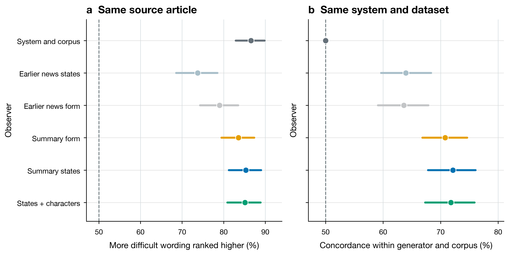

# Predicting whether a professional reader can understand a short English summary

In the English SEAHORSE test, professional readers judged 211 of 4,355 summaries unreadable or incomprehensible. An observer fitted to their training judgments ranked difficult summaries above understandable ones with AUROC .842 (95% article-bootstrap interval .811–.870). It estimated the response probability more accurately than a model of document form and word predictability. At a threshold chosen using validation data, one in three alerts corresponded to a reader reporting difficulty. The study measures the verdict on a complete summary. Localizing the word that caused a verdict requires separate observations. [Original task and reader instructions, §2.2](https://aclanthology.org/2023.emnlp-main.584/) · [Original release, CC BY 4.0](https://github.com/google-research-datasets/seahorse) · [Registered analysis](transition-seahorse-protocol.md)

## Human exposure and model

US English raters saw the summary alone when answering question 1. They first saw the source article at question 4. The released English summaries cover XSum and XL-Sum news and WikiLingua instructions, with outputs from several systems and human references. We kept each printed summary intact, grouped drafts by original article and reserved the original test set. To prevent overlap from earlier to later partitions, we excluded whole training or validation articles with an exact summary or a shared run of 12 normalized words. This removed 265 training and 26 validation judgments. A further historical wording match involved five original test articles. Removing all five left the AUROC at .841. Across the original partitions, 21,247 unique texts were registered. Qwen3.5-2B encoded 21,240 once each. Four exceeded the 1,024-token limit and three contained no usable printed word. [Grade-free input seal](../results/reading-validation-transition-external/seahorse/exposure-seal.json) · [Exposure audit](../results/reading-validation-transition-external/seahorse/historical-exposure.json)

The primary head projects the middle and final native token states, measures word predictability and attention to earlier sentences, and pools 86 sentence measurements by their mean and log mean exponential. For multi-sentence summaries the pool contains the noninitial sentences. For one-sentence summaries it uses the initial sentence. Adding the 15 form and predictability measurements yields 187 features. We minimized binary negative log likelihood with equal total weight per original article and a fixed ridge penalty of .002. The maximum gradient at the native optimum was below 10⁻⁸. The 14,482 training and 2,156 validation judgments included 618 and 96 difficult summaries, respectively. Validation supplied a nonnegative calibration slope, intercept and alert threshold. We sealed probabilities, parameters and thresholds before examining the test responses. The reference-free writer head receives no identifier for the article, dataset or generating system. [Fit and convergence](../results/reading-validation-transition-external/seahorse/fit-seal.json) · [Serving specification](../results/reading-validation-transition-external/seahorse/serving/spec.json)

## Outcome and controls

The test contains 1,005 source articles, 4,355 released judgments and 4,351 distinct printed summaries. The source responses were 4,143 Yes, 211 No and one Unsure. Five articles shared a whitespace-only summary that received five No responses. The observer abstained on that text. This leaves 4,350 probability estimates and 4,349 definitive, scored judgments, of which 206 (4.74%) were No. Intervals below resample complete source articles, preserving the dependence of multiple summaries of a single article. [Complete counts, scoring and exclusions](../results/reading-validation-transition-external/seahorse/scores.json)

| Information available | AUROC | Average precision for No | Negative log likelihood |
|---|---:|---:|---:|
| 15 document form and word-predictability features | .830 | .299 | .1581 |
| Same features and native sentence measurements, as served | .842 | .307 | .1484 |
| Character n-grams and document form | .836 | .310 | .1514 |
| Character n-grams and native measurements | .849 | .326 | .1444 |
| Generator and corpus identifiers alone | .847 | .219 | .1484 |
| Generator, corpus and form | .873 | .340 | .1399 |
| Generator, corpus and native measurements | .880 | .356 | .1357 |

The paired native-minus-form difference in negative log likelihood was −.0097 (95% interval −.0188 to −.0032). With character n-grams available to both systems it was −.0071 (−.0143 to −.0018). When the generator and corpus were also supplied, the estimate was −.0042 (−.0115 to .0013). The native head assigned an average 4.14% probability to No, below the observed 4.74%. At the frozen .1141 alert threshold it found 92 of the 206 scorable difficult summaries, missed 114 and flagged 184 of 4,143 understandable summaries. That yields 44.7% recall, 33.3% precision and 4.44 false alerts per 100 understandable summaries. Counting every abstention as a missed alert gives 43.6% recall on all 211 No judgments. [Paired estimates and threshold counts](../results/reading-validation-transition-external/seahorse/scores.json) · [Registered character comparator](transition-seahorse-text-control.md)

Across 962 pairs of drafts from the same source with opposite judgments, native scores ranked the difficult draft higher 85.3% of the time when each of the 179 informative articles contributed equally (81.2–89.0%). Form scores reached 83.6%. The paired difference was +1.75 percentage points (−1.62 to +5.08). Completely frozen scores trained to rank *coherence* in a previous news experiment reached 73.7%, versus 79.0% for their matched form control (−5.28 points, −9.53 to −1.04). This loss of transfer establishes a consequential difference between these two human questions. [Previous observer replay](../results/reading-validation-transition-external/seahorse/news-observer-replay.json) · [Whole-article comparisons](../results/reading-validation-transition-external/seahorse/scores.json)

**Figure 1.** Points give observed concordance and bars give 95% article-bootstrap intervals. The left panel asks which of two summaries of the same article received the reader's No response. The right panel asks which summary received No among pairs from the same generator and corpus. The dashed line marks a random choice. [Vector figure](../results/reading-validation-transition-external/seahorse/summary-understanding.pdf)

## Published task-specific evaluator

The authors’ published Q1-specific mT5-Large checkpoint outperformed the summary-only observer on the same 4,349 definitive judgments. Its AUROC was .913, average precision .431 and negative log likelihood .1308. The corresponding CogLLM differences were −.071 AUROC (−.102 to −.042) and +.0175 log loss (+.0071 to +.0279). For paired drafts averaged over 179 informative articles, mT5 reached 87.4% concordance versus 85.3% for CogLLM (difference −2.10 percentage points, −6.52 to +2.51). The specialist saw the article and summary in the authors' input format. The human Q1 judge and CogLLM saw the summary alone. We verified all 1,005 original source articles and all 484 available reference summaries by official GEM identifier. Of the 4,355 inputs, mT5's 2,048-token limit showed the full summary in 4,318, part in 4 and none in 33. On the 4,312 definitive shared rows with the whole summary visible, AUROC remained higher for mT5 (.915 versus .845). [Released specialist](https://huggingface.co/google/seahorse-large-q1) · [Paired specialist comparison](../results/reading-validation-transition-external/seahorse/specialist-comparison.json)

## Dependence on genre, producer and reader

Within the same generator and corpus, 27,514 opposite-verdict pairs in 22 informative strata yielded AUROC .721 (.678–.761) for the native head and .708 for document form. Generator/corpus alone calls every such pair a tie. The native increment of .013 (−.017 to .043) is imprecise. Across the instruction subset, WikiLingua, only 23 of 1,426 scorable drafts received No and native average precision was .059. It reached .341 in English XL-Sum (80 of 1,461) and .377 in XSum (103 of 1,462). In a post-primary check, the verdicts of two producers reversed between two source articles on 1,493 occasions. The native observer identified the interaction direction in 81.4% of these comparisons, versus 81.1% for form. These paired controls support text-dependent prediction while limiting the evidence for extra ranking information in the native representation. [Stratified agreement and secondary reversals](../results/reading-validation-transition-external/seahorse/ranking-sensitivity.json)

The separate duplicate-response file supplied 1,047 definitive ballots for 351 qualifying individual summaries from 248 articles. On these ballots the native head achieved negative log likelihood .0807, versus .0857 for form. Across 1,041 within-summary ballot pairs, judges disagreed in 30 pairs. Equal weighting per summary gives 2.85% observed pair disagreement, versus 7.13% implied by independent draws from the model probability. The release has no persistent rater identifiers. The data support a probability of a population response but do not establish individual-reader calibration. [Repeated-judgment results](../results/reading-validation-transition-external/seahorse/scores.json)

A subsequent repeated-ballot analysis estimated dependence from separate training articles. Its group-count log loss was lower than under independent draws, although the disagreement estimate remained high and uncertainty in source calibration included zero benefit. A separate analysis of the next two questions reached AUROC .930 for unnecessary repetition and .683 for grammatical issues among summaries that raters could already understand. At that point the article was still hidden. [Repeated-ballot analysis](transition-seahorse-repeated-results.md) · [Conditional repetition and grammar judgments](transition-seahorse-gated-results.md)

## Reproduction

The compact serving head retains the trained feature order, calibrator and source threshold. Replaying the production feature aggregation on the original held word archive reproduced all 4,350 reported probabilities with maximum absolute difference below 5 × 10⁻¹⁶ and identical decisions, including explicit abstention on the whitespace-only text. The synthetic bridge-repair example and a WikiLingua example selected by its hash provide two English writer fixtures. [Production mathematical replay](../results/reading-validation-transition-external/seahorse/serving-replay.json) · [Serving implementation](summary_understanding.py)

A fresh NVIDIA L4 replay used 67 presentations. The 65 scorable held summaries reproduced their earlier probabilities to within .00000230 and all produced the same screening decisions. One additional synthetic presentation was scored, bringing the total to 66 full-passage encoder calls. One whitespace-only input abstained before encoding. The ordinary author interface displayed 1.63% for the synthetic passage and 1.99% for the selected WikiLingua sample, whose original judge answered Yes. A separate demonstration selected the largest predicted risk from the fixed 66 published-source fixtures without inspecting its response. Its probability was 48.97%, above the source threshold, and its original judge answered No. These examples illustrate different decisions. The full-cohort threshold counts above measure accuracy. [Native serving replay](../results/reading-validation-transition-external/seahorse/serving-native-verification.json) · [Human Yes example](../results/reading-validation-writer/summary-study-example.html) · [Human No example](../results/reading-validation-writer/summary-review-example.html)
