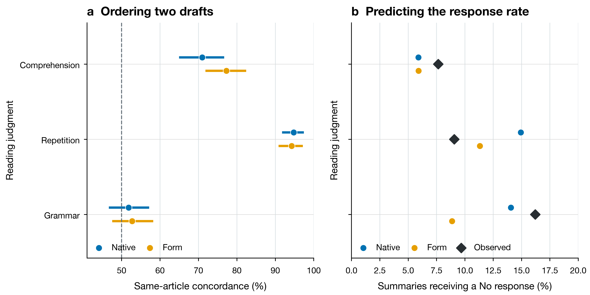

# English reading judgments transfer most clearly to repetition in Spanish

An English-trained observer ranked Spanish summaries containing unnecessarily repeated information above alternatives that Spanish readers accepted in 94.8% of same-article comparisons (95% article-bootstrap interval 92.0–97.1%). A matched observer using just form and word predictability reached 94.3%. Comprehension was harder to transfer, and grammar judgments were close to chance when comparing summaries of the same article. These results use original Spanish text and professional judgments of the same task, collected within the same multilingual study. English researchers’ scores and English parameters were fixed before any Spanish responses were inspected. [Original human instrument](https://aclanthology.org/2023.emnlp-main.584/) · [Protocol](transition-seahorse-spanish-protocol.md) · [Sealed model outputs](../results/reading-validation-transition-external/seahorse/spanish-forecast-seal.json)

The public test supplied 2,854 original judgments, 2,849 distinct strings and 990 underlying articles from Spanish XL-Sum and MLSum news and WikiLingua instructions. Six records across three distinct strings lacked usable word or sentence measurements, all judged incomprehensible. Of the remaining 2,848 forecasts, one got an uncertain first response. The two subsequent questions only contribute when the same rater had answered Yes to the first. All native model coefficients, original English calibration slopes, segmentation and vocabulary features were left fixed. The standalone English production readout reproduced the independent research projection to within 6.7 × 10⁻¹⁶ on the scorable Spanish inputs. [Signed exposure and original text checks](../results/reading-validation-transition-external/seahorse/spanish-exposure-seal.json) · [Every scored and omitted response](../results/reading-validation-transition-external/seahorse/spanish-results.json)

| Spanish human judgment | Scored / No | Native AUROC | Form AUROC | Native average precision | Native estimated No / observed No |
|---|---:|---:|---:|---:|---:|
| Cannot understand the summary | 2,847 / 218 | .711 | .738 | .235 | 5.91% / 7.66% |
| Unnecessary repetition, given comprehension | 2,626 / 238 | .944 | .940 | .812 | 14.93% / 9.06% |
| Grammar problem, given comprehension | 2,629 / 426 | .613 | .634 | .233 | 14.07% / 16.20% |

The table uses the English adaptively shared native and form observers. On the summed proper responses per summary, native log loss was .8096 and form log loss .7941 (paired difference +.0155, −.0001 to +.0308). Native log loss was higher for comprehension and repetition, with simultaneous intervals excluding zero for both. Grammar's native log loss was lower by .0119 (simultaneous interval −.0259 to +.0011). Excluding five full Spanish source-article groups with a normalized wording match to English training or validation left the overall native-minus-form difference at +.0164 (+.0001 to +.0322). Shared names, translated texts and rater identities cannot be fully audited from the public words and worker locales. [Corpus comparisons and exclusion sensitivity](../results/reading-validation-transition-external/seahorse/spanish-results.json)

On 594 opposite-verdict repetition pairs from 196 Spanish articles, the native estimate reached the 94.8% same-article agreement reported above. Holding generator and corpus fixed instead yielded 90.8% (87.8–93.4%). The corresponding same-article values were 71.0% for comprehension (65.3–76.4%, 622 pairs in 192 articles) and 51.9% for grammar (47.0–56.9%, 813 pairs in 239 articles). For comprehension alone, native AUROC was .753 in MLSum news, .779 in XL-Sum news and .542 in WikiLingua instructions. The unchanged English writer threshold gave 86 true alerts, 132 misses and 238 false alerts among 2,629 understandable summaries. It implied 26.5% precision and 9.05 false alerts per 100 understandable summaries, approximately twice the English false-alert rate. The production writer remains scoped to short English summaries. [Matched judgments, genre breakdown and threshold transfer](../results/reading-validation-transition-external/seahorse/spanish-results.json)

**Figure 1.** Left, mean within-article concordance on pairs with opposite human responses, with 95% resampling intervals for complete Spanish source articles. Right, forecast and observed No rates in the three original units. Repetition and grammar rates are conditional on a prior comprehension Yes judgment. [Vector figure](../results/reading-validation-transition-external/seahorse/spanish-transfer.pdf)
