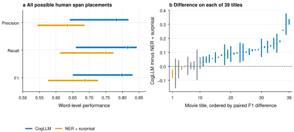

# Identifying insufficiently introduced characters for writers

A writer who accepts the default English narrative screen receives word-level suggestions at a threshold of 0.27462. A suggestion asks whether the character at that word has been introduced clearly enough. The score represents evidence for the span annotation used by SNaC. A separate high-recall setting uses the earlier threshold of 0.05204. Both settings reuse one causal forward over the article and the same trained weights.

Eleven source-development books supplied 9,280 words, including 251 marked words. Separately maximizing word F1 on these books selected the thresholds for CogLLM and for a person-name tagger augmented with Qwen word surprisal. CogLLM recovered 157 source labels and raised 75 additional flags. Its source precision was 0.677. The 39 movie titles had served earlier analyses. These comparisons assess an independently selected operating decision on previously examined material. [Source decisions](../results/reading-validation-transition-t5/source-equal-f1-thresholds.json)

| Unit and fully measurable outcomes | CogLLM precision / recall / F1 | NER plus surprisal | Paired F1 improvement, 95% movie bootstrap |
|---|---:|---:|---:|
| 22,133 words, 413 marked | .782 / .816 / .799 | .634 / .751 / .687 | +.111 [.080, .145] |
| 1,416 sentences, 250 marked | .824 / .936 / .876 | .753 / .840 / .794 | +.082 [.055, .111] |

The word result comprised 337 true flags, 94 false flags and 76 misses. The control recovered 310 human marks, issued 179 false flags and missed 103. Paired precision increased by .148 [.104, .193] at words and .071 [.034, .108] at sentences. For sentence evaluation each method used its own development-selected threshold on the largest word score in the sentence. The writer marks words with the word-level policy. [Matched decisions and paired uncertainty](../results/reading-validation-transition-t5/type-calibration/qwen-ner-source-matched-movies.json)

Repeated wording in the original summaries sometimes permits several possible positions for the same reader's annotation. We retained all 26,417 movie words and allowed each recorded span to occupy any one of its original matching occurrences. These choices admit 629 to 632 marked words. CogLLM flagged 650 words and the control flagged 712.

| Performance across every possible annotation placement | CogLLM | NER plus surprisal | Sharp paired difference |
|---|---:|---:|---:|
| Precision | .642–.818 | .544–.685 | +.081 to +.143 |
| Recall | .660–.843 | .612–.773 | +.028 to +.081 |
| F1 | .651–.831 | .576–.727 | +.057 to +.114 |
| False flags per 1,000 exposed words | 4.47–8.82 | 8.48–12.30 | −4.28 to −3.03 |

The bounds optimize the shared human labeling for both methods. Their strongest and weakest absolute performances can coincide, which narrows the paired difference. Averaging each title's sharp improvement gave F1 bounds of +.057 to +.118. Resampling complete titles and retaining each title's admissible uncertainty gave a 95% envelope of +.027 to +.145. The corresponding precision envelope was +.036 to +.166. Among 39 movie titles, F1 always favored CogLLM in 29 and the control in two. Recall's title-level envelope included zero. Generated English narrative summaries define the evaluated population. [Every title and all admissible placements](../results/reading-validation-transition-partial/serving/balanced-all-words.json) · [Decision policy](../results/reading-validation-transition-partial/serving/character-operating-points.json) · [Evaluation protocol](transition-balanced-word-protocol.md)

A fresh Colab L4 production replay reproduced every reported coordinate and score, with 650 balanced word marks and 1,467 high-recall marks. Its 42 inputs required 42 encoder forwards, including the Unicode, punctuation-only and suffix cases. The largest absolute replay error was 7.8 × 10⁻¹⁶. [Native replay](../results/reading-validation-transition-partial/serving/balanced-l4-replay.json)

**Figure.** Left, horizontal ranges include the best and worst admissible location of every original character annotation. Points give results on the 22,133 fully measurable words. Right, each bar spans the permitted difference in F1 between the two policies on that title. Blue ranges favor CogLLM; orange ranges favor the NER comparator. Gray ranges include equality.

## A previously untouched fortieth movie

One original SNaC movie had exceeded the 2,048-token deployment window and had been absent from all previous model fitting and scoring. We preregistered its longest complete-segment prefix, fixing both policies in advance. A single causal pass covered 41 of the movie's 53 original annotation segments, 2,036 tokens and 1,777 words. The remaining 390 original words exceeded this prefix. Twenty-one span records included six with repeated wording. Their admissible placements always yield 24 positive words. [Prospective single-title protocol](transition-last-movie-protocol.md) · [Input and scope](../results/reading-validation-transition-snac/unseen-movie/seal.json)

CogLLM issued 29 flags and the NER comparator 28. Across all original span placements, paired F1 favored CogLLM by .022 to .064, precision by .009 to .049 and recall by .042 to .083. False alerts ranged from equality to 0.56 fewer per 1,000 words. Absolute precision ranged from .586 to .793 for CogLLM and .571 to .750 for the comparator. One new title permits a directional case replication. Its uncertainty describes the original span placement within that title. [Single-title counts and sharp bounds](../results/reading-validation-transition-snac/unseen-movie/scores.json)
